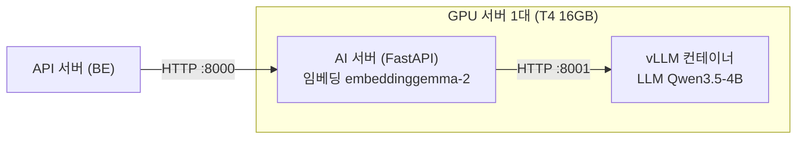

# ADR-0001: GPU·모델 서빙 구성

- 상태: **대체됨** — ADR-0007(AWS Bedrock API 전환, 2026-10-27)로 대체. 아래는 기록용으로 남긴다
- 날짜: 2026-10-22
- 담당: AI
- 관련: 기획서 5.3·8장, 작업목록 D-4 · AI-02 · AI-03, ADR-0002(생성 횟수 상한 없음 → 호출량 증가 가능), ADR-0005(EKS에서 어떻게 띄우는지)

> **이 문서가 정하는 것:** AI 기능에 쓸 **모델 2개**(LLM·임베딩)와 **GPU 서버 1대**의 사양, 그리고 둘을 함께 돌리기 위한 규칙.
> 어디서·어떻게 띄우는지(EKS·Karpenter·Terraform)는 ADR-0005가 정한다.

## 한눈에 보기

| 무엇 | 정한 것 | 상태 |
| --- | --- | --- |
| 글 생성 모델 (LLM) | `Qwen/Qwen3.5-4B`, vLLM으로 서빙 | 제안 (G1 품질 확인 후 확정) |
| 검색용 임베딩 모델 | `google/embeddinggemma-2`, 768차원, 텍스트만 | **결정** (revision 고정) |
| GPU 서버 | AWS 서울 g4dn.xlarge (T4 16GB) 1대, 부족하면 g6.xlarge (L4 24GB) | 제안 |
| 운영 | 쓸 때만 켜고 매일 자동 종료 | 제안 |
| GPU가 꺼져 있을 때 | AI 작업은 바로 실패, 사용자가 다시 시도 | **결정** |

- vLLM과 AI 서버는 **컨테이너를 나눈다**(라이브러리 버전 충돌). GPU 메모리는 vLLM이 80%를 먼저 잡고, 임베딩이 남은 쪽을 쓴다.
- 팀별로 할 일은 아래 [영향](#영향), 아직 안 정해진 것은 [남은 결정](#남은-결정).

## 배경

- LLM은 Qwen3.5 계열을 직접 띄워서 쓰기로 했지만(기획서 v1.7, 당시 9B), 서빙 방식(D-4)과 임베딩 모델은 정하지 않은 상태였다.
- 사용자가 많아질 때를 대비해 LLM과 임베딩 모두 GPU에서 서빙한다.

## 결정 (제안)

| 항목 | 선택 |
| --- | --- |
| LLM | **Qwen/Qwen3.5-4B**, vLLM으로 서빙, `--language-model-only`(이미지 입력 기능은 올리지 않음). 2026-10-22에 9B에서 변경(아래 "변경") |
| 품질이 부족할 때 | ① 9B 양자화: `RedHatAI/Qwen3.5-9B-FP8-dynamic`(L4), `RedHatAI/Qwen3.5-9B-quantized.w4a16` ② `Qwen/Qwen3.5-9B`(L4) |
| 임베딩 | **google/embeddinggemma-2**, **텍스트만** 임베딩, 768차원, GPU 서빙. 텍스트 인코더만 로드 |
| 인프라 | AWS 서울 리전 GPU 1대 (EKS 노드로 운영, ADR-0005). **g4dn.xlarge(T4 16GB) 기본**, 품질·속도가 부족하면 g6.xlarge(L4 24GB) |
| 운영 | 사용할 때만 켜고, 매일 정해진 시간에 자동 종료(EKS CronJob으로 replicas 0, ADR-0005). AWS Budgets 알림 설정 |
| 정밀도 | L4: LLM BF16 또는 FP8, 임베딩 BF16 / T4: LLM FP16, 임베딩 FP32 (T4는 BF16·FP8 미지원, 임베딩을 FP16으로 돌리면 NaN(계산 오류 값) 위험) |
| 라이선스·다운로드 | 두 모델 모두 **Apache-2.0**(상업 사용 가능), Hugging Face 공개 모델(gated 아님)이라 받을 때 토큰이 필요 없다. Gemma 금지 용도 정책(Prohibited Use Policy)은 지킨다 (2026-10-23 확인) |

### 지켜야 할 규칙

| 규칙 | 이유 |
| --- | --- |
| **임베딩 모델의 revision과 차원은 고정한다.** `embedding_model` 값에 함께 기록한다(예: `google/embeddinggemma-2@<rev>:768`). BE가 벡터 저장을 시작하기 전(묶음 1 끝)에 확정한다 → 2026-10-23 확정 | 바꾸면 저장된 벡터를 전부 다시 계산해야 한다 |
| **임베딩 접두어는 AI 서버가 붙인다.** 질의: `task: search result \| query: …` / 문서: `title: … \| text: …` | API는 원래 텍스트만 보내면 된다. 접두어 규칙이 한 곳에 있어야 문서·질의 벡터가 어긋나지 않는다 |
| **경량화는 LLM 쪽에서만 한다.** | LLM은 환경변수만 바꾸면 교체할 수 있지만, 임베딩은 모델을 바꾸면 전체를 다시 계산해야 한다 |
| **vLLM과 임베딩은 서로 다른 컨테이너(환경)로 분리한다.** | 두 쪽이 요구하는 transformers 버전이 충돌한다(Kaggle 테스트에서 확인) |
| **임베딩은 텍스트 인코더만 올린다.** 불러올 때 `vision_config`·`audio_config`를 `None`으로 준다. 텍스트만 써도 `pillow`·`torchvision`은 설치해야 한다(sentence-transformers가 처리기를 만들 때 필요) | 이미지·음성 인코더를 만들지 않아 가중치가 FP32 2.77GB → 약 1.01GB로 줄고, 벡터는 같다 |
| **vLLM을 먼저 띄우고 준비가 끝난 뒤 AI 서버(임베딩 포함)를 띄운다.** 실행 설정은 AI 레포 `docker-compose.yml` | vLLM은 시작할 때 GPU 메모리의 `gpu-memory-utilization`(0.80)만큼을 먼저 잡으므로, 순서가 바뀌면 시작에 실패한다 |

## 영향

- **BE**
  - AI 서버 연결 실패를 짧은 타임아웃(예: 2초)으로 감지해 AI 작업 상태를 "실패(GPU 서버 꺼짐)"로 기록한다(BE-18).
  - 사례 확정은 성공 처리하고, 청크를 "임베딩 대기" 상태로 저장해 AI 서버 `/health`의 `models.embedding`이 `ready`가 되면 다시 처리한다(`llm` 상태는 보지 않음. 아래 "변경" 2026-10-23, 기획서 v1.29).
  - 검색 점수 기준선으로 후보를 거르지 않는다(아래 "임베딩 검색 평가").
  - pgvector 컬럼 차원을 768로 맞춘다(계약 C-04에 명시).
- **FE:** 작업 상태의 실패 이유가 "GPU 서버 꺼짐"이면 "잠시 후 다시 시도"를 안내한다(C-02 공통 3, 기존 F4 메시지 재사용).
- **비용:** GPU 요금은 켜 둔 시간만큼 나간다. 인스턴스를 꺼도 EBS(디스크) 요금은 계속 나간다. NAT Gateway는 만들지 않는다. 클로즈드 베타(4주) 동안 24시간 운영할 예산은 없으므로, G3 전에 운영 방식을 따로 정한다.

## 남은 결정

- [ ] G1: Qwen3.5-4B로 평가 세트(AI-11)의 재구성·매칭 품질과 응답 시간을 측정한다. 미달이면 9B 양자화 또는 9B(L4)와 비교해 모델과 인스턴스를 다시 정한다.
- [ ] 동시 요청: T4에서 동시 4·8·16개 요청의 응답 시간과 VRAM을 측정한다(AI 레포 `evals/load_test.py`).
- [ ] GPU 서버를 켜는 데 걸리는 시간 실측(Karpenter 노드 생성 + 모델 로딩). 지금은 "몇 분, 첫 실행은 최대 15분" 추정값이다.
- [ ] 베타 운영 방식: 정해진 시간에만 운영 / 추가 예산 / 토큰 단위 과금 API로 전환 중 선택한다.
- [x] 임베딩: 텍스트 인코더만 로드했을 때 전체 모델과 같은 벡터인지 확인하고, revision을 고정한다 → `google/embeddinggemma-2@914f7f89142e33e77833254d9c9b90c3cef7303b:768`로 결정 (2026-10-23).
- [x] GPU가 꺼져 있을 때 AI 작업을 바로 실패시킬지, 대기시켰다가 GPU가 켜지면 처리할지 정한다 → MVP는 **바로 실패 + 사용자가 다시 시도**로 결정 (2026-10-23). 대기 방식은 베타 운영 방식이 정해지면 다시 본다.

## GPU 서버에서 처음 확인할 것 (docker compose)

Kaggle에서는 두 모델을 같은 T4에 올려 확인했지만(아래 근거), AI 레포의 실행 설정(`docker-compose.yml`, AI 서버 이미지)으로는 아직 돌려 보지 않았다. GPU 서버(EC2 한 대로 시험하거나 EKS 노드)를 처음 띄울 때 아래 순서로 확인한다.

- [ ] **AI 컨테이너만 먼저** (`docker compose up -d --no-deps ai`): AI 서버 이미지의 torch 2.14.1(CUDA 13)이 서버 드라이버(580 이상 필요)에서 도는지, 임베딩 VRAM 실측(`nvidia-smi`). 추정은 약 1.5~2GB(아래 `/embed` 확인의 메모리). `/health`가 `embedding: ready`, `llm: error`면 정상
  - 참고 (2026-10-25, 개인 Windows 데스크톱 GTX 1660 SUPER 6GB: T4와 같은 Turing 세대, Docker Desktop·WSL2, 드라이버 596. Mac은 CUDA 컨테이너를 못 돌려 이 항목을 로컬에서 볼 수 없다): 이미지가 그대로 돌고(`torch 2.14.1+cu130`, CUDA 인식), 모델 캐시가 있을 때 켜서 `embedding: ready`까지 90초, `llm: error`(vLLM 없음)로 정상. 임베딩 VRAM은 로딩 뒤 약 1.1GB, 긴 문서 32개를 한 번에 넣은 뒤 약 1.8GB(PyTorch 캐시 포함)로 추정 안이다. **이 항목의 완료는 T4·리눅스 드라이버에서 확인한 뒤로 본다.**
- [ ] **전체** (`docker compose down && docker compose up -d`): vLLM이 healthy가 된 뒤 AI 서버가 뜨는지, 두 모델 합계 VRAM이 15,360MiB 안인지, `/health`가 모두 `ready`인지
- [ ] **vLLM만 재시작될 때**: 임베딩이 GPU를 잡은 상태에서 vLLM이 다시 뜨면 `gpu-memory-utilization`(0.80)만큼을 못 잡아 실패할 수 있다. 실패하면 AI 서버도 함께 재시작하는 방법을 정한다
- [ ] **켜는 데 걸리는 시간** (첫 실행 / 캐시가 있을 때) → 위 남은 결정, 기획서 5.5 "최대 15분" 갱신
- [ ] **리포트 20초 목표**: `/requirements/extract` + `/match` + `/gap-guide` 합계. Mac(bf16)에서는 약 80~110초였다(추출 11~14초 + 판정 53~73초 + 갭 가이드 16~26초). 검증에 걸려 다시 생성하면 그 단계가 두 배가 된다(`/gap-guide`가 API 제한 20초를 넘으면 기본 문구로 대체, ADR-0003)
- [ ] **동시 호출 부하**: `/match`는 요건 수만큼, `/guide`는 탭 5개를 동시에 부른다(vLLM `--max-num-seqs 16`). 분석 2~3건이 겹칠 때 API 읽기 제한(`/match` 30초, `/guide` 120초) 안인지 `evals/load_test.py`로 잰다. 넘으면 "탭을 열 때 그 탭만 만들기"(C-02 S09 확인할 것 1)로 동시 호출을 줄인다

---

아래는 위 결정의 **근거가 된 테스트 기록**이다. 용어는 맨 아래 [용어](#용어)를 본다.

## 근거: Kaggle T4 테스트 (2026-10-22)

> **요약:** T4 한 장에 LLM(4B)과 임베딩을 함께 올려도 메모리가 들어가고, 재구성 응답이 목표(15초) 안에 나온다. 임베딩 검색만으로는 정답이 1위가 아닐 때가 있어 `/match` 판정 단계가 필요하다.

**환경:** Tesla T4 15GB 1장(GPU 0번만 사용), driver 580, vllm 0.32.0, torch 2.13.0+cu130, transformers 5.20.2, sentence-transformers 6.2.0
**모델:** Qwen3.5-4B(FP16)와 embeddinggemma-2(FP32)를 같은 GPU에 올림
**입력:** 기획서 7장 예시 원문(결제 승인 API 프로젝트)으로 재구성 10회

| 항목 | 결과 | 판정 |
| --- | --- | --- |
| VRAM (두 모델 동시) | 13,881 / 15,360 MiB (vLLM 10.9GB + 임베딩 약 3GB) | PASS, 여유 약 1.5GB |
| JSON 스키마 강제 | 10/10 | PASS |
| thinking 끄기 (`enable_thinking: false`) | `<think>` 0회 | PASS |
| 재구성 응답 시간 | 중앙값 11.1초 (목표 15초). 첫 실행 몇 번과 일부 실행은 약 20~24초 | PASS |
| 원문에 없는 숫자 | 없음 | PASS |
| 사례 나누기 | 2개 사례로 올바르게 나눔, 원문에 없는 정보는 확인 질문으로 남김 | 육안 확인 |
| 임베딩 검색 (한글 요건 4개) | top-1 3/4. "대용량 트래픽 처리"의 정답 사례가 2위 | FAIL. 후보 20개 → `/match` 리랭킹 구조가 필요하다는 근거 |

**테스트 중 발견한 설정 (운영에 반영):**

- vLLM 기본값(`max-num-seqs 256`)이면 T4에서 CUDA 그래프를 준비하다가 OOM(메모리 부족)이 난다. `--max-num-seqs 16 --max-cudagraph-capture-size 16`으로 해결했다.
- vLLM이 설치한 torch(cu130)와 기존 torchaudio의 CUDA 버전이 달라 vLLM이 시작하지 못했다. torchaudio를 제거했다(음성 기능은 쓰지 않음).
- embeddinggemma-2를 불러오려면 transformers 5.20 이상과 sentence-transformers 6.1 이상이 필요하다.
- embeddinggemma-2는 이미지·음성 인코더까지 함께 올라가 FP32 기준 약 2.8GB를 차지한다. → 텍스트 인코더만 올리는 방법을 찾아 규칙에 반영했다(아래 임베딩 평가).
- 서버를 켠 직후 첫 요청들은 예열 때문에 느리다. 서버를 켜면 예열 요청을 먼저 보낸다.

**한계:** 재구성 원문 1개로 본 결과다. 4B의 품질은 평가 세트(AI-11)로 G1에서 다시 측정한다.

## 근거: 임베딩 검색 평가 (2026-10-22)

> **요약:** 정답이 있는 요건 11개 중 9개는 1위로 찾는다. 약어("MSA")는 잘 못 찾고, "맞는 경험이 없음"은 점수로 가를 수 없다 → 약어 확장 필요, 점수로 후보를 거르지 않는다.

**환경:** Mac M3(MPS), FP32, AI 레포 `evals/embed_eval.py` · `evals/embed_cases.json` (기획서 4.4 형식 청크 14개, JD 요건 14줄 중 정답 있는 것 11줄)

| 항목 | 결과 |
| --- | --- |
| hit@1 / hit@3 / MRR | 0.82 / 0.91 / 0.86. 정답이 있는 요건은 모두 7위 안 |
| 텍스트 인코더만 vs 전체 모델 | 벡터 코사인 최소 1.000000 (같은 벡터), 가중치 2.77GB → 1.01GB, 검색 지표 같음 (`--compare-full`, 2026-10-23 재측정) |
| 틀린 요건 | "MSA 환경" → 정답(경력, "마이크로서비스")이 7위. "결제·정산 도메인" → 3위(1위와 0.001 차이) |
| 맞는 경험이 없는 요건 | iOS(Swift)·ML 서빙·TDD의 1위 점수(0.67~0.71)가 정답 점수 최저값(0.638)보다 높음 |

- **약어·동의어 확장이 필요하다.** "MSA"처럼 문서에 다른 말로 적힌 경우는 벡터로도 키워드로도 찾기 어렵다(기획서 5.4 요건 정규화, AI 담당). 방식은 아래 "요건 약어 확장 실험"과 작업목록 D-13.
- **검색 점수 기준선으로 후보를 거르지 않는다.** 점수가 0.64~0.71에 몰려 있어 "맞는 경험 없음"을 점수로 가를 수 없다. 항상 상위 후보를 `/match`로 넘겨 판정한다.
- 문서가 14개라 "상위 20개 후보에서 정답이 빠지는 경우"는 확인할 수 없다. 규모는 AI-11에서 키운다.

## 근거: 요건 약어 확장 실험 (2026-10-24)

> **요약:** 약어 뒤에 풀네임만 괄호로 붙여 검색하면 "MSA 환경" 정답이 7위 → 2위로 오르고 다른 요건은 그대로다. 관련어까지 붙이면 오히려 떨어진다 → 작업목록 D-13.

**환경:** Windows CPU, FP32, 위 평가와 같은 `evals/embed_cases.json`. 위 평가 점수가 그대로 나왔다(hit@1 0.82 / hit@3 0.91 / MRR 0.86). 약어가 있는 요건 5줄(RDBMS·MSA·k8s·CI/CD·TDD)에 확장어를 **사람이 써서**(LLM 출력이라고 가정) 질의만 바꿨다. 문서 벡터는 그대로다.

| 질의 | hit@3 | MRR | "MSA 환경" 정답 순위 |
| --- | --- | --- | --- |
| 원문 (지금) | 0.91 | 0.86 | 7위 |
| **원문 (풀네임)** 예: `MSA 환경에서의 서버 개발 경험 (마이크로서비스 아키텍처)` | **1.00** | **0.89** | **2위** |
| 원문 (풀네임 + 관련어) 예: `(마이크로서비스 아키텍처, 분산 시스템, 서비스 분리, Kubernetes, Kafka)` | 0.91 | 0.87 | 4위 |
| 원문과 풀네임을 따로 검색해 문서별 높은 점수 | 1.00 | 0.89 | 2위 |

- **풀네임만 원문 뒤에 붙인다.** 관련어를 덧붙이면 문장 뜻이 흐려져 순위가 떨어진다. 따로 검색해도 결과가 같아 `/embed`·검색을 두 번 할 이유가 없다.
- 정답이 있는 요건 중 약어가 없는 7줄은 순위가 그대로이고, RDBMS·k8s·CI/CD는 확장 전후 모두 1위다.
- 확장하면 맞는 경험이 없는 요건의 1위 점수도 오른다(TDD → "테스트 주도 개발": 부하 테스트 사례가 0.681 → 0.686, 따로 검색하면 0.755). 점수로 거르지 않고 `/match`가 판정하는 지금 규칙을 유지한다.
- **한계:** 문서 14개, 확장어는 사람이 썼다. P2가 실제로 만드는 확장어와 뜻이 여러 개인 약어(PM·CS·QA 등)는 AI-16에서 확인한다 → 바로 아래 "P2 약어 확장어 확인".

## 근거: P2 약어 확장어 확인 (2026-10-25~26, AI-16)

> **요약:** P2가 만든 확장어로 검색하면 "MSA 환경" 정답이 7위 → 1위로, 사람이 쓴 확장어(2위)보다 낫다. 4B에 기술명과 약어를 한 번에 시키면 둘 다 나빠져서 AI 서버 안에서 두 번 부른다. 약어 줄이 1~2개뿐인 요청에서도 풀리도록 풀네임을 비울 수 없게 하고, 이름·여러 뜻인지는 표시만 받아 코드가 버린다.

**환경:** Mac M3 16GB, llama.cpp `Qwen3.5-4B` **bf16** GGUF(팀 로컬 기준, AI 레포 README "A. 로컬 Mac" 4단계). 방식 비교(아래 첫 표)는 개인 Windows 데스크톱(GTX 1660 SUPER 6GB, GGUF Q8_0)에서 했고, `p2_v2` 첫 버전은 두 환경에서 묶음 26/28·MRR 0.94로 같았다. GPU 서버(vLLM FP16)는 아직이다. 확인 세트는 AI 레포 `evals/extract_cases.json` 28줄(위 평가 질의 14줄 + 약어 6줄 + 뜻이 여러 개인 약어 8줄). 프롬프트 예시와 같은 약어는 세트에 넣지 않았다.

| 방식 | 확장어 맞음 | 기술명 `skills_raw` (`p2_v1`과 비교) |
| --- | --- | --- |
| 한 프롬프트에 "약어를 찾아 풀어라" | 19~22/28 (프롬프트 예시에 MSA·k8s 등이 있을 때는 그 약어만 풀고, 예시를 다른 약어로 바꾸자 거의 다 비움) | 재지 않음 |
| 한 프롬프트 + 코드가 찾은 약어 후보를 줌 | 25~27/28 | 2~4개 더 빠뜨림 (같은 기술명 9개 중 `p2_v1` 8개, 이 방식 4~6개) |
| 기술명·약어를 따로 부름 + 후보 + 온도 0 (`p2_v2` 첫 버전) | 26/28 (3회 같음) | **같음** (`extract_eval` 기대값 9/9) |

| 질의 (위 평가와 같은 문서 14개) | hit@1 | hit@3 | MRR | "MSA 환경" 정답 순위 |
| --- | --- | --- | --- | --- |
| 원문 | 0.82 | 0.91 | 0.86 | 7위 |
| 사람이 쓴 확장어 | 0.82 | 1.00 | 0.89 | 2위 |
| **P2 확장어** 예: `MSA 환경에서의 서버 개발 경험 (Microservices Architecture, 마이크로서비스 아키텍처)` | **0.91** | **1.00** | **0.94** | **1위** |

**약어 줄이 적을 때 (Mac, 2026-10-26).** 첫 버전은 8줄씩 묶어 재서 몰랐는데, 약어 호출에는 후보가 있는 줄만 가므로 실제 공고(약어 줄 1~2개)에서는 거의 다 비웠다. `fixtures/jd.json` 6줄을 보내면 RDBMS 확장어가 빈 목록이었다. `extract_eval`은 이제 한 줄씩도 잰다.

| 약어 호출 (28줄) | 한 줄씩 | 8줄 묶음 |
| --- | --- | --- |
| `p2_v2` 첫 버전 | 21 | 26 |
| 빠진 후보를 알려 다시 요청 | 후보는 적지만 풀네임은 비움 | — |
| 예시 대화 1쌍 붙임 | 23 | 26 |
| 규칙("이름이면 비움"·"여러 뜻이면 비움")을 하나씩 뺌 | 11~16/20 | — |
| **풀네임 최소 1개 강제 + `is_name`·`ambiguous` 표시 → 코드가 버림 + 숫자 줄임말(k8s)은 이름 아님 (`p2_v2`)** | **27** | **26~27** |
| 위 + "개발자 공고에서 가장 흔한 뜻" 문구 | 27 | 25 |
| 약어 없는 줄도 문맥으로 함께 보냄 (약어 줄 1 + 일반 5줄, 20건) | 19/20 | 약어 줄만 보낼 때와 같음 |

- 모델은 비워 둘 수 있으면 비우는 쪽을 쉽게 골랐다. 특정 규칙 하나가 원인이 아니었다. 스키마로 `full`을 비울 수 없게 하고, 버릴지는 표시(`is_name`·`ambiguous`)로 받아 코드가 정한다. 건너뛴 후보는 알려서 1회 다시 요청한다.
- k8s는 "Kubernetes라는 이름"으로 보고 `is_name`을 켜기도 해서, 숫자 줄임말은 코드가 이름으로 보지 않는다.
- 출력 필드가 늘어 Mac 응답 시간이 8줄에 약 24초 → 약 43초로 늘었다. `jd.json` 6줄은 약 13초.

- **약어 후보는 코드가 찾는다.** 대문자가 절반 이상인 짧은 영문 토큰(MSA, CI/CD, IaC)과 k8s 같은 줄임말이다. 후보 없이 시키면 4B가 약어를 거의 다 비워 둔다. 모델은 따로 물으면 RDBMS·MSA·DDD·BI·OOP·ML의 풀네임을 모두 맞혔다.
- **온도 0.** 0.7이면 같은 입력에서 묶음 하나(8줄)를 통째로 비우는 등 24~26/28로 흔들렸다. 다른 엔드포인트는 그대로 0.7이다.
- **영문·한글 확장어를 함께 붙이면 낫다.** 영문만 붙은 실행은 RDBMS가 1위 → 2위로 내려갔다(경험 기록이 한글). 다만 "둘 다 꼭 쓰라"고 시키면 모델이 PM까지 풀고 한자가 섞인 말("도메인 주导向 설계")을 만들어 오히려 나빠졌다(24~25/28). 지금 프롬프트는 "영문·한글로 적는다"까지만 쓴다.
- 정답이 없는 TDD 질의의 1위 점수는 0.681 → 0.663으로 내려갔다(Q8_0 0.659, 사람 확장어는 0.686으로 올랐음). 검색 표는 Mac에서도 같았다.
- **한계:** MSA를 한 줄로만 보내면 "Multi-Service Architecture"로 틀리게 푼다(묶음에서는 맞음). 평가 세트에 있는 약어라 프롬프트 예시로 맞추지 않았다. 뜻이 여러 개인 SE("Software Engineer")·PO("제품 소유자")를 풀 때가 있다. 첫 버전은 "PM 협업 경험" 등에서 PM을 "Project Manager"로 풀었는데 지금은 비운다. 뜻이 여러 개인 약어 목록을 BE 사전에 두어 확장어를 버릴지는 D-13·BE-04에서 정한다. vLLM(xgrammar)에서 `minItems`가 지켜지는지는 GPU 서버에서 확인한다.
- **응답 시간:** 8줄 기준 두 호출을 차례로 해서 Mac bf16 약 43초, 데스크톱 Q8_0(첫 버전) 약 10초다(llama-server 슬롯 1개). vLLM에서는 두 호출이 동시에 돈다. 리포트 20초 목표는 GPU 서버에서 잰다.

## 근거: AI 서버 `/embed` 확인 (2026-10-23)

> **요약:** AI 서버를 거친 `/embed` 응답이 계약대로 나오고(768차원, 정규화), LLM이 없어도 임베딩은 따로 동작한다. 짧은 기술 청크가 사례 청크보다 위로 올라오는 문제가 있다 → D-12.

**환경:** Mac (Apple Silicon) 로컬 `real` 모드, MPS, FP32. AI 서버를 거쳐 `/embed`를 호출했다(위 평가는 모델 직접 호출). 입력은 `fixtures/` 청크 13개(`document`)와 `jd.json` 요건 6개(`query`).

| 항목 | 결과 |
| --- | --- |
| 응답 | `embedding_model` = `google/embeddinggemma-2@914f7f89142e33e77833254d9c9b90c3cef7303b:768` (확정값), `dim` 768, 벡터 길이 모두 768 |
| 값 | NaN 없음, 노름 1.000 (정규화됨 → pgvector `<=>`(코사인)와 내적의 순위가 같다) |
| 시간 (Mac, GPU 서버 기준 아님) | document 13개 7.7초(첫 호출), query 6개 0.25초 |
| 입력 규칙 | 빈 `items` → 422 |
| LLM 없이 | LLM 주소가 닿지 않아도 임베딩은 따로 올라가고 `/embed`가 동작한다(`/health`: `llm` error, `embedding` ready). → API는 `embedding`이 `ready`이면 임베딩 대기 청크를 재처리한다(아래 "변경", 기획서 v1.29) |

**메모리 (Mac MPS, FP32, 단독 프로세스):**

| | 가중치 | 프로세스 | MPS 확보 (아주 긴 입력 약 8K 토큰) |
| --- | --- | --- | --- |
| 텍스트 인코더만 | 1.01GB | 약 3.0GB | 약 2.0GB (2.4GB) |
| 전체 모델 | 2.77GB | 약 5.0GB | 3.6GB (5.1GB) |

- 짧은 청크는 개수가 늘어도(104개) 메모리가 거의 늘지 않는다.
- **T4 추정(실측 아님):** 텍스트 전용은 가중치 + CUDA 기본 사용량 + 계산 공간 약 1.5~2GB로, vLLM(80%) 뒤 남는 약 3.0GB 안에 들어간다. GPU 서버에서 AI 컨테이너만 먼저 띄워(`docker compose up -d --no-deps ai`) `nvidia-smi`로 확인한다.

**검색 순위:** 요건별로 `match.json`의 근거 청크가 13개 중 몇 위인지 봤다. "하이브리드"는 API 서버 검색 SQL(벡터 점수 × 0.7 + 기술명 겹침 × 0.3, BE `docs/03-테이블-설계.md`)을 같은 식으로 계산한 것이다.

| 요건 | 요건 기술 | 벡터만 | 하이브리드 | 하이브리드 1위 |
| --- | --- | --- | --- | --- |
| 11 Java/Spring 3년 이상 | Java, Spring | 1, 3 | 1, 3 | 경력 |
| 12 RDBMS 설계·쿼리 튜닝 | 없음 | 6 | 6 | 기술 MySQL |
| 13 대용량 트래픽 처리 | 없음 | 6 | 6 | 기술 Kafka |
| 14 Kafka 등 메시지 큐 운영 | Kafka | 6 | **2** | 기술 Kafka |
| 15 결제·금융 도메인 | 없음 | 4, 9 | 4, 9 | 기술 Redis |
| 16 Kubernetes 운영 | Kubernetes | 근거 없음 | 근거 없음 | 기술 AWS |

- **짧은 기술 청크가 위를 차지한다.** "Kafka · infra · 실무 사용 · …" 같은 기술 청크가 사례 청크보다 점수가 높아, 근거 사례가 4~9위로 밀린다.
- **기술명 겹침 점수는 요건에 기술이 있을 때만 돕는다**(14번 6위 → 2위). 기술이 없는 요건(RDBMS·대용량 트래픽·결제 도메인)은 사례를 끌어올리지 못하는데, 이런 요건일수록 사례가 근거가 된다.
- 지금은 청크가 13개라 상위 20개 후보에 모두 들어간다. 사용자 청크가 수백 개면 사례가 후보에서 빠질 수 있다 → D-12, AI-11.
- `match.json`의 근거는 `/match` 판정 후의 최종 근거라 검색 정답과 같지 않다(14번은 기술 Kafka 청크도 근거가 될 수 있다). 검색 평가에는 정답을 따로 만든다(AI-11).

## 근거: 검색 후보 구성 비교 (2026-10-26, D-12)

> **요약:** 지금 방식(벡터 상위 20 + 기술명 겹침, 0.7/0.3)은 후보 20개 중 평균 15개가 기술 청크라 사례 정답의 18%가 후보에서 빠진다. 청크 종류별 상위 N을 뽑으면 정답이 거의 다 들어간다(재현율 0.91 → 0.99) → D-12 제안.

**환경:** Mac M3(MPS), FP32. AI 레포 `evals/search_eval.py` · `evals/search_cases.json`. 사용자 4명(백엔드·프론트엔드·데이터·DevOps)이 청크를 36~39개씩 가진다(기술 22개 안팎, 경력 2~3, 프로젝트 5, 사례 7~9). 청크는 기획서 4.4·`fixtures/chunks.json` 형식이고, 요건 43줄(맞는 경험 없음 4줄)에 근거가 될 청크를 사람이 붙였다. 질의는 `원문 (확장어…)`(D-13).

| 방식 | 재현율 (후보 20) | 정답 모두 포함 | 사례 정답 재현율 | 후보 20개 구성 (기술/경력/프로젝트/사례) | 재현율 (후보 10) |
| --- | --- | --- | --- | --- | --- |
| 지금: 벡터 상위 20 + 기술명 겹침, 0.7/0.3 | 0.91 | 30/39 | 0.82 | 14.9 / 1.4 / 1.3 / 2.3 | 0.76 |
| **청크 종류별 상위 N** (같은 점수로 기술 5 · 경력 3 · 프로젝트 4 · 사례 8, 모자라면 나머지에서 채움) | **0.99** | **38/39** | **0.98** | 6.3 / 2.3 / 4.0 / 7.5 | **0.95** |
| 순위 합산 (RRF, k=60) | 0.95 | 34/39 | 0.91 | 14.5 / 1.5 / 1.5 / 2.6 | 0.90 |

- **기술 청크가 후보를 채운다.** 기술 청크는 짧고 요건과 단어가 겹쳐 점수가 높다. 빠지는 정답은 거의 사례다. 예: "장애 대응 및 온콜 경험"의 알림 노이즈 사례, "Kubernetes 운영 경험"의 EKS 이전 사례.
  - `/match`는 후보 안에서만 근거를 고르므로(기획서 5.5), 후보에서 빠진 사례는 판정에서 쓰이지 못한다.
- **기술명만 겹친 청크는 후보에 들어가지 못한다** (벡터 상위 20 밖이면서 기술명이 겹친 청크 18개 중 0개).
  - 벡터 20위의 점수도 0.7 × 0.635 = 0.445다. 기술명 겹침만으로 받는 점수는 0.3이라 항상 밀린다.
  - 그래서 지금 점수 합산에서 기술명 겹침은 순서만 바꾸고 새 후보를 넣지 못한다.
- 약어 확장어 없이 원문으로만 검색해도 순서가 같다(0.90 / 0.99 / 0.95).
- **청크 종류별 상위 N에서 빠진 1건:** "장애 대응 및 서비스 안정성 개선"에 붙인 배포 자동 롤백 사례. 질의와 표현이 멀다.
- **한계**
  - 사람이 쓴 4명 데이터다. 실제 사용자의 기술·사례 수에 따라 몫(5/3/4/8)을 다시 본다.
  - 후보 재현율만 봤다. 판정이 실제로 나아지는지는 판정 평가(AI-11)에서 본다.

## 변경

시간 순서. 위 본문은 마지막 변경까지 반영한 상태다.

- **2026-10-22 · LLM 9B → 4B, 인프라 T4 기본:** T4 16GB 한 장에서 4B와 임베딩을 함께 올려 동작을 확인했고(위 Kaggle 테스트), 예산상 L4보다 T4가 유리하다. 9B는 품질이 부족할 때의 대안으로 둔다.
- **2026-10-22 · 임베딩은 텍스트만:** 이미지·음성은 임베딩하지 않는다(ADR-0004로 프로젝트 이미지 업로드도 제외). 텍스트 인코더만 올려 VRAM 여유를 늘린다.
- **2026-10-23 · 임베딩 확정:** `google/embeddinggemma-2`, 768차원, revision `914f7f89142e33e77833254d9c9b90c3cef7303b`. `embedding_model` 값은 `google/embeddinggemma-2@914f7f89142e33e77833254d9c9b90c3cef7303b:768`. 텍스트 인코더만 로드한 벡터가 전체 모델과 같음을 확인했다(코사인 최소 1.000000). 바꾸면 저장된 벡터를 전부 다시 계산해야 하므로 BE는 이 값으로 벡터 저장을 시작한다(AI 레포 이슈 #3).
- **2026-10-23 · GPU 꺼짐 시 바로 실패:** 재구성·적합도 분석·작성 방향은 작업에 `failure_code = GPU_UNAVAILABLE`을 남기고 바로 실패시키며, 웹은 "잠시 후 다시 시도"를 안내한다. 임베딩 청크만 "임베딩 대기"로 두고 `/health`의 모델이 모두 `ready`일 때 다시 처리한다(→ 바로 아래 변경으로 `embedding`만 보도록 바뀜). 켜는 데 몇 분~15분 걸리는 작업을 기다리게 하는 것보다 낫고, 대기 방식은 BE 재처리 작업만 붙이면 되므로 베타 운영 방식(정해진 시간에만 운영 등)이 정해진 뒤 다시 본다(AI 레포 이슈 #4).
- **2026-10-23 · 임베딩 대기 재처리는 `embedding` ready로 (제안, BE 확인 필요):** 위 "모두 `ready`일 때"를 바꾼다. 로컬 테스트에서 LLM 주소가 닿지 않아도 임베딩은 따로 올라가 `/embed`가 동작했다(`/health`: `llm` error, `embedding` ready). "모두 ready"면 vLLM만 문제가 있어도 사례 확정 뒤 벡터 저장이 같이 멈춘다. 기획서 v1.29 5.5에 반영.
- **2026-10-25 · P2는 기술명·약어를 따로, 온도 0:** 위 "P2 약어 확장어 확인". 계약(`expansions` 한 필드)은 그대로이고 AI 서버 안에서만 두 번 부른다. 기획서 v1.37 5.5·5.6.
- **2026-10-26 · 검색 후보는 청크 종류별 상위 N (제안):** 위 "검색 후보 구성 비교". D-12, 기획서 v1.39.

## 용어

| 용어 | 뜻 |
| --- | --- |
| 임베딩 | 문장을 숫자 목록(벡터, 768개)으로 바꾸는 것. 뜻이 비슷한 문장끼리 벡터가 가까워져 검색에 쓴다 |
| revision | Hugging Face 모델의 특정 버전(커밋 해시). 고정해야 나중에 모델이 업데이트돼도 벡터가 바뀌지 않는다 |
| VRAM | GPU 메모리. T4는 16GB(실사용 15,360MiB) |
| FP32·FP16·BF16·FP8 | 숫자를 저장하는 정밀도. 낮을수록 메모리를 덜 쓰지만 GPU마다 지원이 다르다(T4는 BF16·FP8 미지원) |
| 텍스트 인코더 | embeddinggemma-2 안에서 글을 처리하는 부분. 이미지·음성 부분은 쓰지 않아 올리지 않는다 |
| 접두어 | 임베딩 전에 문장 앞에 붙이는 표시(`task: search result \| query:` 등). 모델이 질의와 문서를 구분하게 한다 |
| hit@1 · hit@3 | 정답이 1위 · 3위 안에 든 요건의 비율 |
| MRR | 정답 순위의 역수 평균. 1위면 1, 2위면 0.5 … 1.0이 만점 |
| 하이브리드 검색 | 벡터 점수와 키워드(기술명 겹침) 점수를 합쳐 순위를 매기는 검색 |
| 리랭킹 | 검색으로 뽑은 후보(20개)를 LLM이 다시 읽고 순위·판정을 매기는 단계 (`/match`) |
