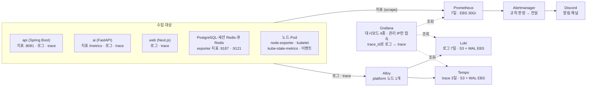

# nerdnam 관측 및 운영 설계

기준일: 2026-11-04

검토 기준은 SPEC v1.67·C-04 v0.5.0, BE `22b53f6`, AI `a0b1c60`, INFRA `06f905d`다. INFRA Git 설정은 api·ai 모두 `AI_QUEUE_ENABLED=true`이며, 앱 기본값은 `false`다. 이 문서의 현재 구성은 코드·배포 설정 기준이고, 실제 클러스터 반영 여부와 전환 후 성능은 별도 확인이 필요하다.

## 1. 개요

nerdnam은 지표(Prometheus), 로그(Loki), 분산 추적(Tempo)을 하나의 Grafana에서 조회하고, 18개 nerdnam 전용 알림 규칙과 kube-prometheus-stack 기본 규칙으로 서비스·인프라·AI 서빙을 감시한다. 이 문서는 무엇을 보고(지표), 어디까지가 정상인지(운영 기준), 어떻게 모으는지(관측 구조)를 정리한다.

| 항목 | 내용 |
| --- | --- |
| 대상 범위 | 서비스(web·api), 인프라(EKS 노드·Pod·저장소), 데이터(PostgreSQL·Redis), AI 서빙(BE AI 작업 큐·AI 서버·Amazon Bedrock) |
| 운영 환경 | AWS EKS 1개, 역할별 워커 3대: app(m7i.xlarge, web·api·ai·Traefik), platform(m7i.xlarge, Argo CD·관측 도구), data(m7i.large, PostgreSQL·Redis·exporter) |
| AI 모델 | LLM `Nova 2 Lite`(Bedrock Converse), 임베딩 `Titan Text Embeddings V2`(1024차원) |
| 관측 도구 | kube-prometheus-stack(Prometheus·Alertmanager·Grafana), Loki, Alloy, Tempo, PostgreSQL·Redis exporter |
| 알림 수신 | Discord 채널(critical·warning만) |
| 관리 방식 | 모든 설정은 INFRA 저장소 Git(`gitops/observability`)에 두고 Argo CD로 배포 |

근거 문서는 INFRA 저장소 `docs/` 아래 관측-작업계획, 추적-작업계획, 운영-검증-작업계획, 부하-시험, web-부하-분석, 알림-Discord, AI-큐-Redis와 SPEC [ADR-0008](../adr/0008-bedrock-throttle-handling.md)·[ADR-0009](../adr/0009-redis-queue-pull.md)다. 임계값 일부는 실측 전 시작값이며, 표에 따로 표시했다.

## 2. 관측 구조

지표는 Prometheus가 각 대상에서 가져오고, 로그와 trace는 Alloy가 받아 Loki·Tempo로 넘긴다. 세 가지를 모두 Grafana 한 곳에서 보고, 알림은 Alertmanager가 Discord로 보낸다.



실선은 데이터가 흐르는 방향, 점선은 Grafana가 조회하는 경로다. 모든 관측 도구는 platform 노드에 있다(node-exporter는 모든 노드).

서비스(api·web)와 AI 서빙(ai)은 지표·로그·trace 세 경로를 모두 쓰고, 데이터·인프라는 지표와 로그로 본다. AI 호출 trace는 메시지의 `traceparent`로 web → api → Redis 큐 대기 → ai → Bedrock을 잇는다. 큐 Redis는 세션 Redis와 분리하며 AOF·RDB·PVC를 쓰지 않는다.

| 구성요소 | 역할 | 저장·보존 | 배치 |
| --- | --- | --- | --- |
| Prometheus | 지표 수집·저장, 알림 규칙 판정 | EBS 30Gi, 7일(20GB 상한) | platform |
| Alertmanager | 알림을 묶어 Discord로 전달 | EBS 2Gi, 120시간 | platform |
| Grafana | 지표·로그·trace 조회, 대시보드 | EBS 5Gi | platform |
| Loki | 로그 저장·검색 | S3 + WAL EBS 10Gi, 7일 | platform |
| Tempo | trace 저장·검색 | S3 + WAL EBS 10Gi, 3일 | platform |
| Alloy | Kubernetes API로 Pod 로그·이벤트 수집, OTLP trace 수신 | — | platform, 1개 |
| node-exporter | 노드 CPU·메모리·디스크 지표 | — | 모든 노드 |
| PostgreSQL·Redis exporter | DB·Redis 지표(업무 데이터를 읽지 못하는 전용 계정) | — | data |

- 관측 도구는 외부에 공개하지 않는다. Grafana만 관리 IP에 열고, 나머지는 클러스터 안에서만 접근한다. NetworkPolicy로 Prometheus → 지표 포트, 앱 → Alloy만 허용한다.
- S3 bucket은 로그·trace를 따로 두고 Pod Identity로만 쓴다(정적 키 없음). EKS 관리형 control plane(etcd 등)은 지표를 열지 않아 수집하지 않는다.

## 3. 주요 관측 지표

지표는 네 계층으로 나눠 본다. 각 계층에서 "사용자가 느끼는 증상"을 먼저 보고, 원인 지표는 그다음에 본다.

| 계층 | 관측 지표 | 지표 이름(Prometheus) | 출처 |
| --- | --- | --- | --- |
| 서비스 | 요청/초, 상태 코드별 요청, 5xx 비율 | `http_server_requests_seconds_count` | BE `/actuator/prometheus`(관리 포트 8081) |
| 서비스 | p95 응답 시간(경로별·전체) | `http_server_requests_seconds_bucket`(구간 0.1·0.3·1·3·10초) | BE |
| 서비스 | DB 연결 풀 사용·대기, JVM heap | `hikaricp_*`, `jvm_memory_*` | BE |
| 서비스 | 수집 상태(살아 있는지) | `up{job="api"}`, `up{job="ai"}` | Prometheus |
| 인프라 | 노드 CPU·메모리(역할별) | `node_*` | node-exporter(모든 노드) |
| 인프라 | Pod CPU·메모리, 재시작·OOM | `container_*`, `kube_pod_container_status_*` | cAdvisor, kube-state-metrics |
| 인프라 | PVC 사용률 | `kubelet_volume_stats_*` | kubelet |
| 데이터 | PostgreSQL 상태·연결 사용률·트랜잭션·잠금·교착·DB 크기 | `pg_up`, `pg_stat_activity_count`, `pg_settings_max_connections` 등 | postgres-exporter |
| 데이터 | Redis별 상태·메모리·명령·연결·오류, 세션 Redis의 AOF | `redis_up`, `redis_memory_used_bytes`, `redis_errors_total`, `redis_aof_last_write_status` | `job="redis-exporter"`(세션), `job="redis-queue-exporter"`(큐) |
| AI 서빙(BE) | Pod 내부 실행 대기·전체 진행 중·실행 스레드·최근 실패 | `nerdnam_aijob_queue_size`, `nerdnam_aijob_in_progress`, `nerdnam_aijob_threads_active`, `nerdnam_aijob_threads_max`, `nerdnam_aijob_failed_recent` | BE. 큐 길이는 Redis 스트림 길이와 다름 |
| AI 서빙(BE) | 임베딩 대기 수·최장 대기 시간 | `nerdnam_chunk_pending`, `nerdnam_chunk_pending_oldest_seconds` | BE |
| AI 서빙(AI) | Bedrock 호출 수(종류·결과별), 호출 시간, 재시도 | `nerdnam_ai_bedrock_calls_total`, `nerdnam_ai_bedrock_call_duration_seconds`, `nerdnam_ai_bedrock_attempts_total` | AI `/metrics` |
| AI 서빙(AI) | 토큰 사용량(입력·출력) | `nerdnam_ai_bedrock_tokens_total` | AI |
| AI 서빙(AI) | 동시 호출 자리 대기·거절 수, 경로별 요청 p95 | `nerdnam_ai_bedrock_queue_wait_seconds`, `nerdnam_ai_bedrock_queue_rejected_total`, `nerdnam_ai_request_duration_seconds` | AI. Redis 큐 전체 대기 시간은 아님 |
| AI 서빙(큐) | 아직 안 꺼낸 메시지·꺼낸 뒤 미완료 메시지·큐 접속 상태 | `nerdnam_ai_queue_lag`, `nerdnam_ai_queue_pending`, `nerdnam_ai_queue_up` | AI. `stream=llm·embed·embed-bg`별로 확인, `queue_up`은 작업자를 켰을 때만 존재 |
| AI 서빙(단계) | 큐·한도기·Bedrock 소요 시간, 현재 한도기·Bedrock 호출 중 수 | `nerdnam_ai_stage_seconds`, `nerdnam_ai_inflight` | AI. `stage=queue·limiter·bedrock`(inflight는 limiter·bedrock), `model`별 |

- 라벨은 경로 템플릿·작업 종류·모델·결과처럼 값이 정해진 것만 쓴다. `member_id`, 작업 id, trace id는 라벨로 만들지 않고 로그 본문에만 남긴다.
- 로그는 `cluster`, `namespace`, `pod`, `container`, `app`, `node` 라벨로 찾는다. 프롬프트·응답 본문·이력서 원문·쿠키·토큰은 수집하지 않는다.

## 4. 정상 운영 기준

아래 "정상" 범위 안이면 조치하지 않고, "주의"는 원인을 살피며, "장애"는 즉시 대응한다. 주의·장애 값은 대부분 알림 규칙과 같아, 기준을 넘으면 Discord로 알림이 온다.

| 계층 | 항목 | 정상 | 주의(warning) | 장애(critical) | 근거 |
| --- | --- | --- | --- | --- | --- |
| 서비스 | BE·AI 수집 | 계속 up | — | 5분 수집 실패 | 알림 `NerdnamApiDown`, `NerdnamAiDown` |
| 서비스 | API p95 응답 시간 | 0.8초 미만(실측 약 0.1초, 부하 시 6~25ms) | 3초 초과 10분(초당 0.1건 이상일 때) | — | 알림 `NerdnamApiLatencyHigh`, 부하 시험 |
| 서비스 | web p95 응답 시간 | 1.5초 미만(실측 20~70ms, 초당 100번까지) | 1.5초 초과 1분 지속 | — | 부하 시험 한도 판단 |
| 서비스 | 요청 실패 비율 | 1% 미만 | 1% 초과 1분 지속 | — | 부하 시험 한도 판단 |
| 서비스 | web 처리량 | Pod 1개당 초당 115건 미만(HPA로 1~2개) | CPU가 요청값에 붙음 | — | web 부하 분석(2026-11-03) |
| 인프라 | 노드 CPU | 80% 미만 | 80% 초과 1분 지속 | — | 부하 시험 한도 판단 |
| 인프라 | Pod 메모리 / limit | 90% 미만 | 90% 초과 | OOMKilled·반복 재시작 | 부하 시험, 기본 규칙 |
| 인프라 | 노드·PVC | 노드 3대 Ready, PVC 여유 있음 | PVC 공간 부족 예측 | 노드 NotReady | kube-prometheus-stack 기본 규칙 |
| 데이터 | PostgreSQL | 접속 가능, 연결 80% 미만, 연결 풀 대기 0 | 연결 80% 초과 10분 | 2분 접속 불가 | `NerdnamPostgresConnectionsHigh`, `NerdnamPostgresDown` |
| 데이터 | Redis(로그인 세션) | 접속 가능, 메모리 80% 미만, AOF 정상 | 메모리 80% 초과 10분 | 2분 접속 불가, 쓰기 거부(OOM), AOF 실패 5분 | `NerdnamRedis*` 4개 |
| 데이터 | Redis(AI 큐) | 접속 가능, 메모리 80% 미만 | 메모리 80% 초과 10분 | 2분 접속 불가, 쓰기 거부(OOM) | `NerdnamRedis*` 중 AOF 제외, job으로 구분 |
| AI 서빙 | BE 내부 작업 큐 | 대기 적음, 몰림 뒤 감소 | 50건 초과 10분 | — | `NerdnamAiJobQueueBacklog`. 과거 4스레드의 10건 저하 기준은 큐 전환 후 재측정 |
| AI 서빙 | Redis 요청 lag·pending | 몰림 뒤 감소 | 30분 내내 0 초과이며 현재 값 ≥ 30분 전 값(`embed-bg`는 60분) | — | `NerdnamAiQueueStuck`, `NerdnamAiQueuePendingStuck` |
| AI 서빙 | AI 작업자의 큐 접속 | `queue_up=1` | `queue_up=0` 5분 | — | `NerdnamAiQueueDown` |
| AI 서빙 | AI 작업 실패 | 최근 5분 3건 이하 | 3건 초과 10분 | — | `NerdnamAiJobFailures` |
| AI 서빙 | 임베딩 최장 대기 | 30분 미만 | 30분 초과 10분 | — | `NerdnamEmbeddingStuck` |
| AI 서빙 | Bedrock 호출 실패율 | 20% 이하 | 20% 초과 10분(10분에 5건 이상일 때) | — | `NerdnamBedrockErrorsHigh` |
| AI 서빙 | AI 동시 호출·한도기 대기 거절(503) | 0건 | 최근 10분에 1건 이상인 상태가 1분 지속 | — | `NerdnamBedrockQueueRejected`. BE 접수 거절 503과 다름 |
| 관측 | Loki 수집 | 계속 up | 10분 수집 실패 | — | `NerdnamLokiDown` |

- 임계값은 소량 실측으로 정한 시작값이다. API·web·Bedrock 수치는 2026-10-30~11-03 부하 시험과 ADR-0008 재현으로 확인했고, 나머지는 실제 트래픽을 보고 조정한다.
- 현재 구성은 역할별 노드 1대, api·ai·DB·세션 Redis·큐 Redis 각 1개라 **고가용성·무중단을 목표로 하지 않는다.** 서비스 수준 목표(SLO)는 이 구성에 맞춰 아래 표로 정한다.
- AI 작업은 비동기라 HTTP 응답 시간에 들어가지 않는다. AI 서빙의 정상 여부는 큐·실패·Bedrock 지표로 따로 본다.

### 서비스 수준 목표(SLO)

SLO는 최근 7일 동안 사용자가 겪은 서비스 품질의 목표다. Prometheus 보존 기간이 7일이라 평가 기간도 7일로 두었다. 목표를 넘기지 않고 허용되는 실패의 양을 오류 예산이라고 부른다.

| SLO | 측정(SLI) | 목표(7일) | 오류 예산(7일) | 측정 방법 |
| --- | --- | --- | --- | --- |
| API 가용 시간 | BE 지표 수집이 성공한 시간의 비율 | 99.0% | 약 1시간 40분 | Prometheus |
| API 요청 성공률 | 5xx가 아닌 요청의 비율 | 99.5% | 요청 200건 중 1건 | Prometheus |
| API 응답 시간 | 1초 안에 끝난 요청의 비율 | 95% | 요청 20건 중 1건 | Prometheus |
| AI 작업 성공률 | 끝난 AI 작업 중 COMPLETED의 비율 | 95% | 작업 20건 중 1건 | DB `app.ai_job` |
| AI 작업 완료 시간 | 끝난 AI 작업 중 5분 안에 COMPLETED된 비율 | 90% | 작업 10건 중 1건 | DB `app.ai_job` |

이 값으로 정한 이유:

- **99.0%가 이 구성의 현실적인 상한이다.** api·DB·Redis가 각 1개라 BE 교체마다 수십 초, 노드 교체마다 수 분이 멈춘다. Redis가 오래 멈추면 BE 재연결에 약 2분이 더 걸린다. 99.9%(7일에 10분)는 노드 교체 한 번으로 다 쓴다.
- **응답 시간 1초**는 실측 p95(약 0.1초)보다 넓고 알림 기준(3초)보다 좁다. BE 응답 시간 구간(0.1·0.3·1·3·10초)에 1초가 있어 정확히 셀 수 있다.
- **AI 작업 성공률 95%**는 기존 운영 목표로 유지한다. 전환 전 HTTP 경로 시험에서는 작성 방향 몰림 중 실패 5건이 있었지만, 큐 전환 후 실패율을 뜻하지 않는다. ADR-0009 재시험 목표는 같은 부하에서 실패 0이며, 재측정 후 SLO를 검토한다.
- **AI 완료 시간 5분**은 사용자가 화면에서 기다릴 수 있는 한계로 두었다. 기획서의 성능 목표(재구성 15초, 리포트 20초, 방향성 60초)는 개선 목표로 따로 둔다. 작은 데이터에서도 `/match` 하나가 41~63초가 걸려 지금은 SLO로 지킬 수 없다.
- web(Next.js)은 자체 지표가 없어 SLO에서 뺀다. API SLO가 사용자 경로를 대신한다.

측정에서 빼는 시간은 계획된 중지(`scripts/cluster.sh down`), 미리 알린 점검, 부하 시험이다. 클러스터를 내리면 Prometheus도 멈춰 그 시간은 가용 시간 계산에 들어가지 않는다. 부하 시험 요청과 시험 계정의 AI 작업은 계산에서 뺀다.

오류 예산을 쓴 정도에 따라 아래처럼 운영한다.

| 예산 사용 | 운영 |
| --- | --- |
| 50% 미만 | 평소대로 배포한다 |
| 50% 이상 | 새 기능을 배포하기 전에 예산을 쓴 원인을 확인하고, 안정화 작업을 먼저 한다 |
| 100% 소진 | 장애 수정·되돌리기 외의 배포를 멈추고, 원인과 재발 방지를 장애 기록에 남긴다 |

측정 식(Prometheus, 7일):

```promql
# API 가용 시간
avg_over_time(up{namespace="nerdnam", job="api"}[7d])

# API 요청 성공률
1 - sum(increase(http_server_requests_seconds_count{namespace="nerdnam", job="api", status=~"5.."}[7d]))
  / sum(increase(http_server_requests_seconds_count{namespace="nerdnam", job="api"}[7d]))

# API 응답 시간(1초 안에 끝난 비율)
sum(increase(http_server_requests_seconds_bucket{namespace="nerdnam", job="api", le="1.0"}[7d]))
  / sum(increase(http_server_requests_seconds_count{namespace="nerdnam", job="api"}[7d]))
```

측정 식(PostgreSQL, 7일, 작업 종류별):

```sql
SELECT job_type,
       avg((status = 'COMPLETED')::int) AS success_rate,
       avg((status = 'COMPLETED' AND finished_at - requested_at <= interval '5 minutes')::int) AS within_5min_rate
FROM app.ai_job
WHERE status <> 'IN_PROGRESS'
  AND requested_at >= now() - interval '7 days'
GROUP BY job_type;
```

- AI 작업은 BE 지표에 완료·실패 누적 수가 없어 DB로 잰다. 주 1회 위 조회를 돌려 기록한다.
- 접수 단계의 503 `AI_UNAVAILABLE`은 작업 행이 없어 AI 작업 SLO에 잡히지 않는다. API 5xx와 시작 요청의 503을 함께 보고, 작업 생성 후 `TIMEOUT`·`GPU_UNAVAILABLE`·`AI_ERROR`와 구분한다.
- SLO는 아직 알림에 연결하지 않았다. 오류 예산을 빨리 쓰는 상황 알림(burn rate)과 AI 작업 누적 지표는 후속 작업이다.
- 목표값은 운영 데이터가 4주 쌓이면 다시 본다.

## 5. 알림과 대응

알림은 Prometheus 규칙 → Alertmanager → Discord 채널로 간다. critical·warning만 보내고 Watchdog·info는 보내지 않는다.

| 구분 | 규칙 수 | 내용 |
| --- | --- | --- |
| nerdnam.app | 11 | BE·AI 수집 실패, API p95, Bedrock 실패율·대기열 거절, AI 작업 실패·BE 큐 적체, Redis 큐 lag·pending 정체·접속 실패, 임베딩 지연 |
| nerdnam.data | 6 | PostgreSQL 접속·연결, Redis 접속·메모리·쓰기 거부·AOF |
| nerdnam.logs | 1 | Loki 수집 실패 |
| 기본 규칙 | kube-prometheus-stack | 노드·Pod 재시작/OOM·PVC 공간·인증서 등. EKS가 열지 않는 etcd·scheduler·controller-manager·kube-proxy 규칙은 끔 |

- 규칙 정의: INFRA `gitops/observability/templates/rules.yaml`. 각 규칙의 안내 문구에 먼저 확인할 곳을 적어 두었다.
- Discord 웹훅 URL은 Secrets Manager `nerdnam/dev/monitoring`에만 두고 External Secrets로 클러스터에 넣는다.

알림이 오면 아래 순서로 본다.

1. **증상 확인(지표)**: Grafana `nerdnam 서비스`·`nerdnam 데이터` 대시보드에서 언제부터, 어느 계층에서 시작됐는지 본다.
2. **원인 찾기(로그)**: 같은 대시보드의 "오류 로그" 패널 또는 Explore → Loki에서 해당 Pod 로그와 Kubernetes 이벤트를 본다.
3. **한 건 확인(trace)**: 로그의 `trace_id`를 눌러 Tempo로 가서, 요청이 web → api → ai → Bedrock 중 어디서 길어졌는지 본다.
4. **조치**: 설정 문제는 Git 되돌리기 후 Argo CD sync, 앱 문제는 이전 이미지 digest로 되돌린다(배포 runbook).

## 6. AI 서빙 관측

큐 경로에서는 BE가 작업 단계를 Redis Streams에 넣고 가상 스레드로 결과를 기다린다. AI 작업자가 메시지를 꺼낸 뒤 모델별 한도기에서 호출 차례를 기다린다. 한도기가 먼저 속도를 조절하므로 **throttle이 없어도 한도 포화로 대기할 수 있다.** 큐는 처리량을 늘리는 장치가 아니라 재시도 낭비를 줄이고 기다릴 곳을 마련하는 장치다.

| 단계 | 역할 | 한도 | 보는 지표 |
| --- | --- | --- | --- |
| BE AI 작업 풀 | 재구성·분석·작성 방향을 비동기로 실행 | 큐 경로 가상 스레드 64, Pod 내부 대기 200. HTTP 경로는 스레드 4 | `nerdnam_aijob_queue_size`, `nerdnam_aijob_threads_active`, `nerdnam_aijob_threads_max`, `nerdnam_aijob_failed_recent` |
| Redis 요청 스트림 | `ai:req:llm`·`embed`·`embed-bg`에 작업 단계 저장 | `XLEN(llm)+XLEN(embed)` ≥ 200이면 새 작업 접수 거절(처리 중·재전송 메시지 포함, `embed-bg` 제외) | `nerdnam_ai_queue_lag`, `nerdnam_ai_queue_pending` |
| AI 작업자 | 메시지를 꺼내 기존 라우터 실행 | `llm` 8, `embed` 2, `embed-bg` 1. 문서 작업자는 사용자 임베딩을 우선 확인 | `nerdnam_ai_queue_up`, `nerdnam_ai_stage_seconds` |
| 모델 한도기 | HTTP·큐 공통, Bedrock 호출마다 차례 배정 | Nova 20·Titan 60회/분, 프로세스 메모리 버킷. 현재 TPM 제한은 구현하지 않음 | `nerdnam_ai_inflight{stage="limiter"}`, `nerdnam_ai_stage_seconds{stage="limiter"}` |
| BE 문서 임베딩 | 확정한 문서 청크를 검색 근거로 저장 | `ai:req:embed-bg`로 분리, 호출별 결과 대기 상한 적용 | `nerdnam_chunk_pending`, `nerdnam_chunk_pending_oldest_seconds` |
| Bedrock | Nova `converse`, Titan `invoke_model` | 계정 한도가 처리량 상한. AI Pod를 늘리기 전에 한도기 공유 필요 | `nerdnam_ai_bedrock_calls_total`, 호출 시간, 재시도, 토큰 |

대기 시간과 실패는 다음 기준으로 구분한다.

| 항목 | 현재 동작 |
| --- | --- |
| 작업 전체 기한 | 큐 경로 `job-timeout=20m`. 접수 시각부터 재며 분석의 AI 호출 4번이 같은 기한을 공유한다. 각 호출은 `wait-timeout=20m`과 작업 잔여 시간 중 짧은 쪽만 기다린다. 기한이 이미 지났으면 다음 단계를 넣지 않는다 |
| 결과 재요청 | `resend-after=5m`마다 같은 `id`로 다시 넣는다. AI는 실행 중 선점·완료 표시로 중복을 억제하고, BE는 기다리는 결과 하나만 반영한다 |
| 중단된 BE 작업 정리 | 1분마다 `alive_at` 갱신, 마지막 생존 시각 기준 `stale-after=25m`로 정리. 살아 있는 Pod가 맡은 작업은 제외한다. 작업 기한 20분과 다른 장치다 |
| 접수 실패 | 요청 스트림 상한·큐 Redis 불가·BE 실행기 포화·drain은 시작 요청 503 `AI_UNAVAILABLE`. 작업을 만들지 않는다 |
| 접수 후 실패 | `XADD` 실패는 `GPU_UNAVAILABLE`, 결과 대기 기한은 `TIMEOUT`, 결과 422·502는 `AI_ERROR` |
| AI의 재시도 | 일시적 503은 기본 대기 5초부터 두 배씩 최대 60초에 짧은 무작위 지연을 더해 재시도. 영구 설정·권한 오류와 생성 시간 초과(504)는 502 결과. 큐 결과 status는 200·422·502 |

AI 큐 호출에는 HTTP의 요청 마감(읽기 제한 − 10초)이 없다. 다만 BE 대기 기한과 AI의 오래된 메시지 폐기(`AI_QUEUE_MAX_AGE=30m`)는 남는다. BE 기한 초과가 이미 실행 중인 Bedrock 호출을 취소하지는 않는다.

AI 저하는 아래 순서로 본다.

1. **증상**: 접수 503·완료 시간·최근 실패와 BE 내부 대기, 스트림별 lag·pending을 함께 본다. BE 큐가 0이어도 Redis 큐와 한도기에서 기다릴 수 있다.
2. **원인**: `queue_up`과 큐 Redis 상태를 먼저 보고, `limiter` 증가면 모델 한도, `queue`만 증가면 작업자 수·소비 상태, `bedrock` 증가면 모델 응답 지연을 조사한다. `result="empty"` 등 모델 오류도 throttle과 나눠 본다.
3. **확인**: 같은 trace에서 BE `nerdnam.ai.queue`, AI `queue.wait`·`limiter.wait`·`bedrock.queue`·`bedrock.converse`/`bedrock.invoke_model` 구간을 비교한다. 완료된 span만 보이므로 현재 대기 위치는 `nerdnam_ai_inflight`로 확인한다.

- lag·pending은 **작업 전체가 아닌 단계 메시지 수**다. `/embed` 메시지 1건이 Titan을 최대 32번 부를 수 있다. 처리한 요청은 `XACK`·`XDEL`, 읽은 결과는 `XDEL`하고 결과 스트림 TTL은 1시간으로 둔다.
- `stage_seconds`의 최대 유한 구간은 600초다. 10분을 넘는 대기는 p95만으로 판단하지 말고 lag·pending·완료 시간을 함께 본다. 멈춤 알림은 30분(문서 60분)이므로 BE의 20분 `TIMEOUT`보다 늦게 올 수 있다.
- 큐 Redis 재시작 시 메시지와 중복 방지 키가 사라진다. BE 재전송은 살아서 기다리는 작업에만 해당하고, BE 자체 재시작 후 작업 자동 재개는 지원하지 않는다. 영속 큐나 정확히 한 번 실행을 보장하는 구조로 해석하지 않는다.
- 헬스 체크(`/livez`·`/readyz`)는 저장된 상태만 읽고 유료 모델을 호출하지 않는다.
- 토큰 기반 비용은 추정치다. 응답 없는 호출·재시도 때문에 AWS 청구액과 다를 수 있어 AWS 청구서와 대조한다.

## 7. 운영 절차와 현재 한계

Grafana는 `grafana.nerdnam.click`에서 관리 IP로만 열리고, 대시보드는 Git JSON으로 관리해 화면에서 고칠 수 없다(`editable: false`).

| 대시보드 | 보는 것 |
| --- | --- |
| `nerdnam 서비스` | BE 요청·5xx·p95(경로별), DB 연결 풀, AI 작업 큐·실패, 임베딩 대기, Bedrock 호출·실패율·토큰·재시도·대기열, JVM heap, Pod 메모리·재시작, 오류 로그 |
| `nerdnam 데이터` | PostgreSQL·Redis 상태, DB 크기·연결·잠금·교착, Redis 메모리·AOF, data PVC 사용률 |
| `nerdnam 부하 시험` | k6 요청/초·p95·실패 비율, BE p95·DB 연결 풀, 역할별 노드·Pod 자원 |
| `nerdnam AI 장애 재현` | AI 작업 완료·실패, BE 큐·스레드, Bedrock 호출, 2-1절의 스트림 lag·pending·단계별 대기·큐 Redis 메모리 |
| 차트 기본 대시보드 | 노드·Pod·PVC·Kubernetes 구성요소(kube-prometheus-stack) |

평소 운영 절차는 INFRA 문서를 따른다.

- **배포·되돌리기**: 배포-runbook·AI-큐-Redis. 큐 Redis·Secret·권한을 먼저 준비하고 AI 작업자를 켠 뒤 BE 큐 경로를 켠다. HTTP로 되돌릴 때는 BE부터 끄고 기존 큐 작업의 처리 상태를 확인한 뒤 AI 작업자를 끈다. BE 교체 전 drain으로 새 작업 접수를 막고 진행 작업을 확인한다.
- **중지·재개**: 운영-중지-재개. 비용을 줄일 때 노드 그룹 3개를 0으로 줄이며, 그동안 서비스와 관측이 함께 멈춘다. 2026-11-02 재기동 때 같은 PVC 재연결과 데이터 유지를 확인했다.
- **부하 시험**: 부하-시험-실행. k6 결과를 Prometheus로 보내 같은 Grafana에서 본다.

현재 한계와 후속 계획:

| 한계 | 영향 | 후속 |
| --- | --- | --- |
| 관측 도구가 같은 클러스터의 platform 노드 1대에 있음 | platform 장애 시 Alertmanager도 멈춰 알림이 오지 않음 | 클러스터 밖 최소 알림(CloudWatch EC2 상태) 검토 |
| 보존 기간이 짧음(지표·로그 7일, trace 3일) | 장기 추이를 볼 수 없음 | 필요해지면 remote write 등 장기 저장 추가 |
| trace 샘플링 100%, head sampling | 수집량이 늘면 Tempo·Alloy 부담. 비율을 내리면 오류 trace가 빠질 수 있음 | 수집량 측정 후 10%, 필요하면 tail sampling |
| Argo CD sync 상태·배포 시각 지표 미수집 | 배포 전후 비교를 대시보드에서 못 함 | Argo CD ServiceMonitor 추가 |
| BE HTTP 호출 지표만으로 큐 지연을 설명할 수 없음 | 큐 대기와 한도기 대기를 놓칠 수 있음 | AI 장애 재현 대시보드·큐 trace를 함께 사용 |
| Grafana 부하 조회 중 OOM 이력 | 2026-11-03에 512Mi 상한에서 3회 재시작 | 1Gi 상향·새로 고침 30초 적용 후 추이 확인(장애 리포트 사례 1) |
| 큐 전환 후 동일 부하 결과 미확인 | 과거 4스레드 실측을 새 구성 성능으로 쓸 수 없음 | `JOB_TIMEOUT_SECONDS=1500`으로 재시험. 접수 503·작업 실패·`timeout_k6`를 분리 |
| 고가용성 아님(역할별 노드 1대, api·DB·세션 Redis·큐 Redis 각 1개) | 가용 시간 SLO는 99.0% 목표를 유지. AI 작업 SLO는 DB로만 잼 | AI 작업 누적 지표·burn rate 알림 추가, 4주 뒤 목표 재검토 |
| PostgreSQL S3 백업·복원 시험 보류 | 데이터 손상 시 복구 수단 없음(EBS Retain은 삭제 방지일 뿐) | 백업 CronJob·복원 시험 |
