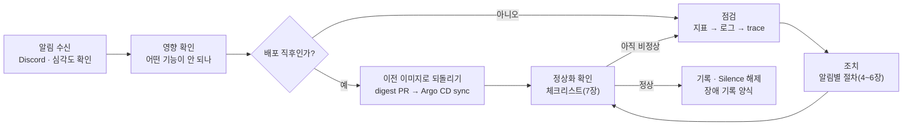

# nerdnam 알림 및 장애 대응 가이드

기준일: 2026-11-03

## 1. 개요

알림은 Prometheus 규칙 → Alertmanager → Discord 채널로 오고, 받은 사람은 이 문서의 알림별 절차로 점검·조치한 뒤 정상화를 확인하고 기록을 남긴다. 알림 기준과 지표의 뜻은 [관측 및 운영 설계](관측-운영-설계.md) 문서를 따른다.

| 심각도 | 뜻 | 대응 |
| --- | --- | --- |
| critical | 서비스 일부가 지금 동작하지 않거나 데이터가 남지 않음(접속 불가, 쓰기 거부) | 바로 점검을 시작하고 팀 채널에 담당을 알린다 |
| warning | 동작은 하지만 느려지거나 곧 문제가 될 상태(지연, 적체, 자원 80% 초과) | 오늘 안에 원인을 확인한다. 오래 계속되면 critical처럼 다룬다 |
| 해결 | 조건이 풀려 Discord에 `[해결]` 메시지가 옴 | 정상화 확인(7장) 후 기록을 닫는다 |

대응 원칙:

- **증상 먼저, 원인은 다음**: 사용자에게 어떤 영향이 있는지부터 확인한다.
- **되돌리기를 먼저 고려**: 방금 배포한 뒤 생긴 장애는 원인을 다 찾기 전에 이전 이미지 digest로 되돌린다.
- **데이터는 지킨다**: PostgreSQL 백업이 아직 없다. PVC·StatefulSet 삭제, 강제 detach, 파괴적 migration은 하지 않는다.
- **수동 변경은 Git으로 돌려둔다**: `kubectl`로 고친 것은 임시 조치다. Argo CD가 다시 덮으므로 같은 내용을 INFRA PR로 남긴다.

필요한 접근:

| 대상 | 접근 방법 |
| --- | --- |
| Grafana | `grafana.nerdnam.click`(관리 IP에서만) |
| Kubernetes | `kubectl --context nerdnam-dev`. namespace: 앱 `nerdnam`, 데이터 `data`, 관측 `monitoring` |
| Alertmanager | `kubectl --context nerdnam-dev -n monitoring port-forward svc/monitoring-alertmanager 9093` |
| Argo CD | `scripts/argo-sync.sh <application>` 또는 Argo CD 화면 |

## 2. 알림 조건

nerdnam 전용 규칙은 15개(critical 6, warning 9)이고, 노드·Pod·PVC는 kube-prometheus-stack 기본 규칙으로 본다. "지속"은 조건이 그 시간 내내 유지돼야 알림이 온다는 뜻이다.

| 알림 | 조건 | 지속 | 심각도 | 의미 |
| --- | --- | --- | --- | --- |
| `NerdnamApiDown` | BE 지표 수집 실패(`up{job="api"} == 0`) | 5분 | critical | api Pod가 죽었거나 응답하지 않음 |
| `NerdnamAiDown` | AI 지표 수집 실패(`up{job="ai"} == 0`) | 5분 | critical | ai Pod가 죽었거나 통신이 막힘 |
| `NerdnamApiLatencyHigh` | BE 전체 p95 > 3초, 초당 0.1건 이상 | 10분 | warning | API 응답이 느림(AI 작업은 포함 안 됨) |
| `NerdnamBedrockErrorsHigh` | Bedrock 호출 실패(throttle·timeout·error) > 20%, 10분에 5건 이상 | 10분 | warning | 모델 한도·권한·리전 문제 |
| `NerdnamBedrockQueueRejected` | AI 대기열이 차 503으로 거절 > 0(최근 10분) | 1분 | warning | 동시 호출 상한에 걸림 |
| `NerdnamAiJobFailures` | 최근 5분 AI 작업 실패 > 3 | 10분 | warning | 분석·가이드 작업이 실패하고 있음 |
| `NerdnamAiJobQueueBacklog` | BE AI 작업 큐 > 50 | 10분 | warning | stale(20분) 전에 처리 못 할 수 있음 |
| `NerdnamEmbeddingStuck` | 임베딩 최장 대기 > 30분 | 10분 | warning | 검색 근거가 비어 판정이 미충족이 됨 |
| `NerdnamPostgresDown` | `pg_up == 0` 또는 지표 없음 | 2분 | critical | DB 접속 불가 |
| `NerdnamPostgresConnectionsHigh` | 연결 수 / max_connections > 80% | 10분 | warning | 연결이 곧 바닥남 |
| `NerdnamRedisDown` | `redis_up == 0` 또는 지표 없음 | 2분 | critical | 로그인 세션 저장소 접속 불가 |
| `NerdnamRedisMemoryHigh` | 메모리 / maxmemory > 80% | 10분 | warning | 꽉 차면 세션 쓰기 실패(noeviction) |
| `NerdnamRedisRejectingWrites` | 5분 안에 OOM 오류 증가 | 즉시 | critical | 새 로그인·세션 쓰기가 실패 중 |
| `NerdnamRedisAofWriteFailed` | AOF 마지막 쓰기 실패 | 5분 | critical | 세션이 디스크에 남지 않음 |
| `NerdnamLokiDown` | Loki 지표 수집 실패 | 10분 | warning | 로그가 저장되지 않을 수 있음 |
| `KubeNodeNotReady` 등 | 노드 NotReady | 차트 기본 | 차트 기본 | 노드 장애 |
| `KubePodCrashLooping` 등 | Pod 반복 재시작·OOMKilled | 차트 기본 | 차트 기본 | 자원 부족·앱 오류 |
| `KubePersistentVolumeFillingUp` | PVC 공간 부족(예측 포함) | 차트 기본 | 차트 기본 | 쓰기 실패 전 단계 |

- 규칙 정의: INFRA `gitops/observability/templates/rules.yaml`. 임계값은 실측 전 시작값이다.
- 점검·부하 시험 중에는 Alertmanager Silence로 해당 알림을 잠시 끈다(matcher 예: `alertname=NerdnamApiLatencyHigh`, 기간 지정).
- 클러스터를 다시 올린 직후에는 Pod 준비 중 알림(`KubePodNotReady` 등)이 잠깐 올 수 있고, 지속 시간이 지나면 해결된다.

## 3. 공통 대응 흐름

모든 알림은 같은 흐름을 따른다. 방금 배포한 뒤라면 원인을 찾기 전에 되돌리고, 아니면 지표 → 로그 → trace 순서로 점검한다.

1. **알림 수신**: Discord 메시지의 알림 이름·심각도·안내 문구를 본다. critical이면 팀 채널에 담당을 알린다.
2. **영향 확인**: 브라우저에서 로그인·목록·분석 중 무엇이 안 되는지, 대시보드에서 언제부터인지 본다.
3. **배포 직후인가**: Argo CD에서 최근 sync 시각과 이미지 digest를 확인한다. 장애 시작과 가까우면 `images.yaml`을 이전 digest로 되돌리는 PR → sync한다. DB schema는 함께 되돌아가지 않는다.
4. **점검**: 지표(대시보드)로 계층을 좁히고, Loki 로그와 Kubernetes 이벤트로 원인을 찾고, `trace_id`로 Tempo에서 느리거나 실패한 구간을 확인한다.
5. **조치**: 알림별 절차(4~6장)를 따른다. 설정 변경은 INFRA PR → Argo CD sync로 한다.
6. **정상화 확인**: 7장 체크리스트. 아직 비정상이면 4로 돌아간다.
7. **기록**: 장애 기록을 남기고 점검 중 걸어 둔 Silence를 해제한다.

## 4. 서비스·AI 서빙 알림 대응

아래 명령은 모두 `kubectl --context nerdnam-dev`를 붙여 실행한다(생략해 적음). 대시보드는 Grafana `nerdnam 서비스`다.

### NerdnamApiDown / NerdnamAiDown (critical)

- **점검**: `-n nerdnam get pods`로 api·ai Pod 상태(Running·CrashLoopBackOff·Pending)를 본다. `describe pod`의 Events에서 OOMKilled·프로브 실패·이미지 pull 오류를 확인하고, `logs deploy/api --since=15m`(ai도 같음)으로 기동 오류를 본다.
- **원인별 조치**:
    - 방금 배포한 뒤라면 `images.yaml`을 이전 digest로 되돌리는 PR → `nerdnam-apps` sync.
    - OOMKilled면 메모리 limit을 올리는 PR(임시로 `rollout restart`).
    - Pod는 Running인데 수집만 실패하면 NetworkPolicy(Prometheus → 관리 포트 8081, ai `/metrics`)와 ServiceMonitor를 확인한다.
    - api readiness가 503이면 DB·Redis 문제일 수 있다 → 5장.
- **정상화 확인**: Pod Ready, `up` 1, 요청/초가 평소 수준으로 복구, 5xx 비율 0에 가까움, 브라우저 로그인 → 프로젝트 목록 열림.

### NerdnamApiLatencyHigh (warning)

- **점검**: "p95 응답 시간(경로별)"에서 느린 경로를 찾고, "DB 연결 풀"의 대기와 JVM heap, app 노드 CPU를 본다. 느린 요청의 trace를 Tempo에서 열어 DB 쿼리·Redis·외부 호출 중 어디가 길었는지 본다.
- **조치**: 연결 풀 대기면 PostgreSQL 연결·잠금 확인(5장). 노드 CPU 80% 초과면 부하 원인(시험·트래픽)을 확인한다. 배포 직후면 되돌린다.
- **정상화 확인**: 전체 p95가 0.8초 미만(평소 약 0.1초)으로 돌아옴.

### NerdnamBedrockErrorsHigh / NerdnamBedrockQueueRejected (warning)

- **점검**: "Bedrock 실패 비율(결과별)"에서 throttle·timeout·error 중 무엇인지, "Bedrock 호출(종류·결과별)"에서 `converse`(Nova)인지 `invoke_model`(Titan)인지 본다. Tempo에서 `{ span.bedrock.result = "throttle" }`로 한 건을 열어 `bedrock.attempts`와 대기 시간을 확인한다. AI 로그의 `bedrock llm … retries`도 본다.
- **원인별 조치**:
    - throttle: 계정 한도(Nova 약 분당 20, Titan 약 분당 60)다. 몰림이 지나길 기다리고, 한도를 쓰는 시험이 돌고 있으면 멈춘다. 공용 계정이라 팀에 알린다.
    - error(권한): AI Pod의 Pod Identity와 Bedrock 모델 접근 권한을 확인한다. `/readyz`에서 llm·embedding이 `ready`인지 본다.
    - timeout·대기열 거절: Bedrock 응답이 느려 동시 호출 8개가 찬 상태다. AWS Health에서 리전 상태를 확인한다.
- **정상화 확인**: 실패 비율 20% 이하, 대기열 거절 0, 재시도 비율(시도 ÷ 호출)이 1에 가까움.

### NerdnamAiJobFailures / NerdnamAiJobQueueBacklog (warning)

- **점검**: "AI 작업 큐·스레드"에서 큐 길이와 실행 중 스레드(최대 4)를 본다. 그다음 Bedrock 호출에 throttle이 있는지 본다(ADR-0008 판정 순서: 큐·실패 → Bedrock 결과 → trace 한 건).
- **원인별 조치**:
    - throttle이 있으면 위 Bedrock 절차를 따른다. 큐는 한도가 풀리면 줄어든다.
    - throttle이 없는데 실패하면 `NerdnamAiDown`·AI 로그의 오류와 계약(응답 형식) 오류를 본다.
    - 큐는 메모리에만 있다. api를 재시작하면 대기 중인 작업은 실패로 정리되므로, 재시작은 마지막 수단으로 둔다. 실패한 작업은 사용자가 다시 요청해야 한다.
- **정상화 확인**: 큐 10건 미만, 최근 5분 실패 3건 이하, 테스트 계정으로 분석 1건이 완료됨(Bedrock 요금이 들어 1건만).

### NerdnamEmbeddingStuck (warning)

- **점검**: "임베딩 대기" 수와 최장 시간, `invoke_model` 호출 결과를 본다. api 로그에서 임베딩 오류를 찾는다.
- **조치**: Titan throttle이면 기다린다. AI 서버 장애면 AI 복구가 먼저다. 대기가 줄지 않으면 BE 담당에게 알린다.
- **정상화 확인**: 대기 수가 줄어들고 최장 대기가 30분 미만.

## 5. 데이터 계층 알림 대응

PostgreSQL과 Redis는 data 노드의 StatefulSet 1개씩(`data/postgres-0`, `data/redis-0`)이다. 대시보드는 Grafana `nerdnam 데이터`다. **백업이 없으므로 PVC·StatefulSet을 지우거나 다시 만들지 않는다.**

### NerdnamPostgresDown (critical)

- **영향**: DB가 필요한 요청이 500을 내고, api readiness가 503이 돼 Service에서 빠진다.
- **점검**: `-n data get pods,pvc`로 postgres-0과 PVC(Bound) 상태를 본다. `describe pod postgres-0`의 Events(OOMKilled, 볼륨 연결 실패), `logs postgres-0 --since=15m`(디스크 가득, 복구 중)를 본다. data 노드가 Ready인지 확인한다.
- **원인별 조치**:
    - 디스크 가득: PVC 크기를 늘리는 PR(StorageClass가 확장 허용). 파일을 직접 지우지 않는다.
    - OOMKilled: 메모리 limit 상향 PR. data 노드는 limit 합이 노드 여유를 넘지 않게 맞춰 두었으므로 합계를 함께 확인한다.
    - 노드 장애: 6장의 노드 절차. 같은 AZ 새 노드에 EBS가 다시 붙는다. 기존 노드가 살아 있을 수 있으면 강제 detach를 하지 않는다.
- **정상화 확인**: `pg_up` 1, api readiness 200, 기존 프로젝트·리포트가 그대로 보임(데이터 유지).

### NerdnamPostgresConnectionsHigh (warning)

- **점검**: "상태별 연결"에서 idle·active·idle in transaction 중 무엇이 늘었는지, 잠금·교착이 있는지 본다. api의 "DB 연결 풀" 패널과 비교한다.
- **조치**: idle in transaction이나 긴 쿼리가 쌓이면 해당 경로를 BE 담당에게 알린다. 부하 시험 중이면 시험을 멈춘다. 연결 풀 크기·max_connections 변경은 PR로 한다.
- **정상화 확인**: 연결 80% 미만, 연결 풀 대기 0.

### NerdnamRedisDown (critical)

- **영향**: 세션이 필요한 요청이 실패한다. api readiness가 약 2초 뒤 503이 돼 사용자는 503을 본다(liveness는 유지돼 api는 재시작하지 않음).
- **점검**: `-n data get pods,pvc`, `describe pod redis-0`, `logs redis-0 --since=15m`. 인증(ACL) 오류·메모리·볼륨 문제를 본다.
- **조치**: Pod 문제면 재시작을 기다리거나 원인(OOM·설정)을 PR로 고친다. 세션은 AOF로 PVC에 남아 있다.
- **정상화 확인**: `redis_up` 1, api readiness 200, 로그인 유지. Redis가 몇 분 이상 멈췄다면 BE 재연결에 최대 약 2분이 더 걸린다(로컬 시험: 3분 중단 후 약 1분 50초). 그동안 기다린 뒤 확인한다.

### NerdnamRedisMemoryHigh (warning) → NerdnamRedisRejectingWrites (critical)

- **점검**: "Redis 메모리"와 키 수 추이를 본다. 세션이 급격히 늘었는지(부하 시험·비정상 접근) 확인한다.
- **조치**: noeviction 정책이라 가득 차면 새 세션 쓰기가 거절된다. maxmemory·메모리 limit을 함께 올리는 PR(AOF rewrite 여유 포함). 원인이 비정상 접근이면 그 출처를 먼저 막는다.
- **정상화 확인**: 메모리 80% 미만, OOM 오류 증가 없음, 새 로그인 성공.

### NerdnamRedisAofWriteFailed (critical)

- **점검**: redis-0 로그의 AOF 오류와 Redis PVC 사용률을 본다. 대부분 디스크 공간·권한 문제다.
- **조치**: 공간 부족이면 PVC 확장 PR. 해결 전까지 재시작하면 그간의 세션이 사라질 수 있다(재로그인 필요).
- **정상화 확인**: `redis_aof_last_write_status` 1, PVC 여유 확보.

## 6. 인프라·관측 장애 대응

노드는 역할별 1대(app·platform·data)라 한 대가 멈추면 그 역할 전체가 멈춘다. 자동 장애 조치(failover)는 없다.

| 장애 | 영향 | 점검 | 조치 | 정상화 확인 |
| --- | --- | --- | --- | --- |
| app 노드 NotReady | web·api·ai·Traefik 전부 중단, 서비스 접속 불가 | `get nodes -L workload`, EC2 상태 검사, `describe node` Conditions(메모리·디스크 압박) | 노드 그룹이 새 EC2로 교체하길 기다린다. 멈춰 있으면 EC2를 종료해 교체를 유도한다 | 노드 Ready, Pod Running, NLB 대상 healthy, HTTPS 접속·로그인 |
| data 노드 NotReady | PostgreSQL·Redis 중단(5장 영향 모두) | 위와 같음 + PVC 연결 상태 | 같은 AZ 새 노드에 EBS가 다시 붙길 기다린다. 강제 detach·PVC 삭제는 하지 않는다 | `pg_up` 0 → 1, `redis_up` 1, 기존 데이터·세션 유지 |
| platform 노드 NotReady | 관측·Argo CD·controller 중단. 서비스는 계속 동작. **Alertmanager도 멈춰 알림이 오지 않음** | Grafana 접속 불가로 알게 됨. `get nodes`, EC2 상태 | 노드 교체를 기다린다. 그동안 서비스는 브라우저로 직접 확인한다 | Grafana 접속, Prometheus 모든 target up, 시험 알림 수신(아래) |
| Pod 반복 재시작·OOMKilled | 해당 구성요소 간헐 중단 | `describe pod`의 Last State(OOMKilled·Error), "Pod 메모리" 패널에서 limit 대비 사용량, `logs --previous` | OOM이면 limit 상향 PR, 앱 오류면 되돌리기. liveness 실패면 부하 때문인지 본다(web은 부하 시 liveness 실패로 재시작한 적 있음) | 재시작 횟수 증가 멈춤, 메모리 / limit 90% 미만 |
| PVC 공간 부족 | 쓰기 실패(DB·Redis·Prometheus·Loki) | "data PVC 사용률", 기본 PVC 대시보드 | PVC 크기를 늘리는 PR. 관측 PVC는 보존 기간·크기 상한도 확인 | 사용률 감소, 쓰기 오류 없음 |
| `NerdnamLokiDown` | 새 로그가 저장되지 않을 수 있음(서비스 영향 없음) | `-n monitoring get pods`, Loki 로그의 S3 권한(Pod Identity) 오류, WAL PVC | Pod 재시작·설정 되돌리기. S3 권한 오류면 Loki 역할 연결 확인 | Loki target up, Grafana에서 최근 5분 로그 조회됨 |

알림이 오는지 의심스러울 때(노드 복구 후, 웹훅 변경 후)는 시험 알림을 보낸다.

1. `kubectl --context nerdnam-dev -n monitoring port-forward svc/monitoring-alertmanager 9093`
2. `localhost:9093/api/v2/alerts`에 `alertname=NerdnamDiscordTest`, `severity=warning`, 끝 시각 5분 뒤인 알림을 POST한다(INFRA `docs/알림-Discord.md` 5장 명령).
3. 약 30초 뒤 `[발생 1건]`, 5분 뒤 `[해결]`이 오면 정상이다. 안 오면 ExternalSecret `alertmanager-discord`이 SecretSynced인지, Alertmanager 로그에 401·404(웹훅 삭제·URL 오류)·429(속도 제한)가 있는지 본다.

클러스터 밖에서 알림을 보내는 장치(CloudWatch EC2 상태, 외부 dead-man)는 아직 없다. platform 장애나 클러스터를 내려 둔 동안(`scripts/cluster.sh down`)에는 알림이 오지 않는다.

## 7. 정상화 확인과 사후 기록

알림이 `[해결]`됐다고 끝난 것이 아니다. 아래 항목을 모두 확인한 뒤 장애를 닫는다.

공통 정상화 확인:

- [ ] Discord에 해당 알림의 `[해결]`이 왔고, 새 알림이 없다
- [ ] `-n nerdnam`, `-n data`, `-n monitoring`의 Pod가 모두 Running·Ready이고 재시작 횟수가 더 늘지 않는다
- [ ] Prometheus target(api·ai·exporter·Loki·Alloy)이 모두 up이다
- [ ] `nerdnam 서비스` 대시보드에서 5xx 비율 0에 가깝고, API p95가 0.8초 미만이다
- [ ] AI 작업 큐 10건 미만, Bedrock 실패 비율 20% 이하다
- [ ] 브라우저에서 로그인 → 프로젝트 목록 → 기존 리포트 열기가 된다
- [ ] AI 경로가 관련됐다면 테스트 계정으로 분석 1건이 완료된다(Bedrock 요금 발생)
- [ ] Argo CD Application이 모두 Synced·Healthy다. `kubectl`로 임시 수정한 것이 있으면 같은 내용을 INFRA PR로 올렸다
- [ ] 점검 중 걸어 둔 Silence를 풀었다

장애 기록은 아래 양식으로 팀 채널에 남긴다. 같은 장애가 다시 생기면 이 문서의 해당 절차에 배운 점을 더한다.

| 항목 | 적을 내용 |
| --- | --- |
| 알림 | 알림 이름, 심각도, 발생 시각 |
| 영향 | 어떤 기능이 얼마나 안 됐는지(접속 불가, 느림, AI 작업 실패 건수), 영향 시간 |
| 타임라인 | 발생 → 인지 → 조치 → 해결 시각 |
| 원인 | 직접 원인과 그 배경(예: Bedrock 한도 → 큐 적체) |
| 조치 | 한 일과 커밋·PR 링크 |
| 정상화 확인 | 위 체크리스트 결과 |
| 후속 | 재발 방지 작업(임계값 조정, 코드 수정, 문서 보강)과 담당 저장소 이슈 |
