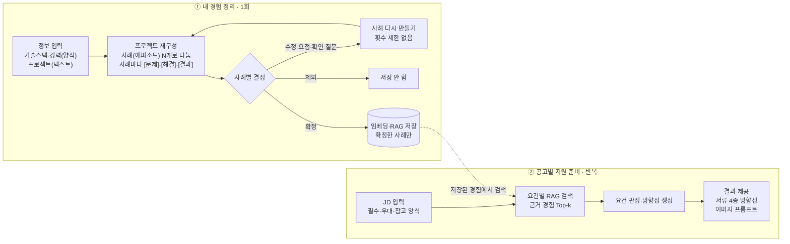
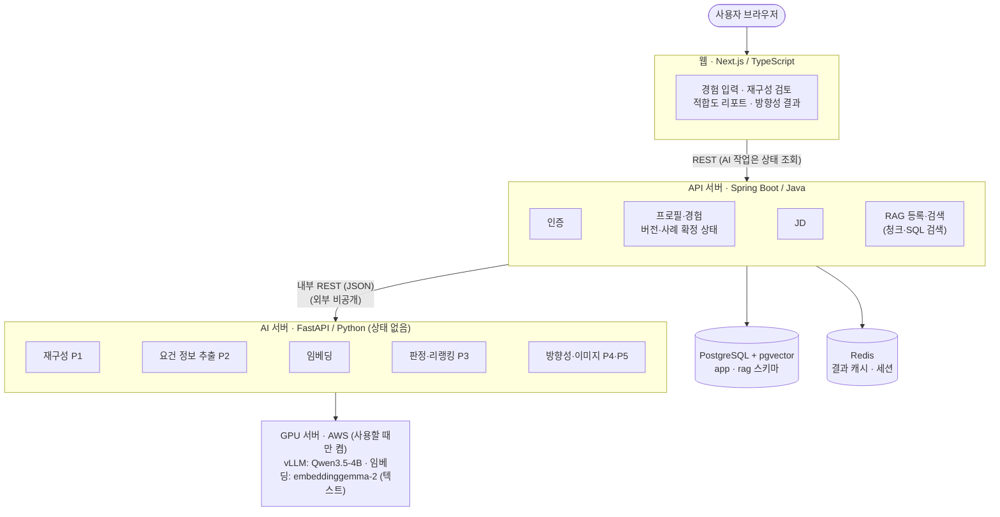
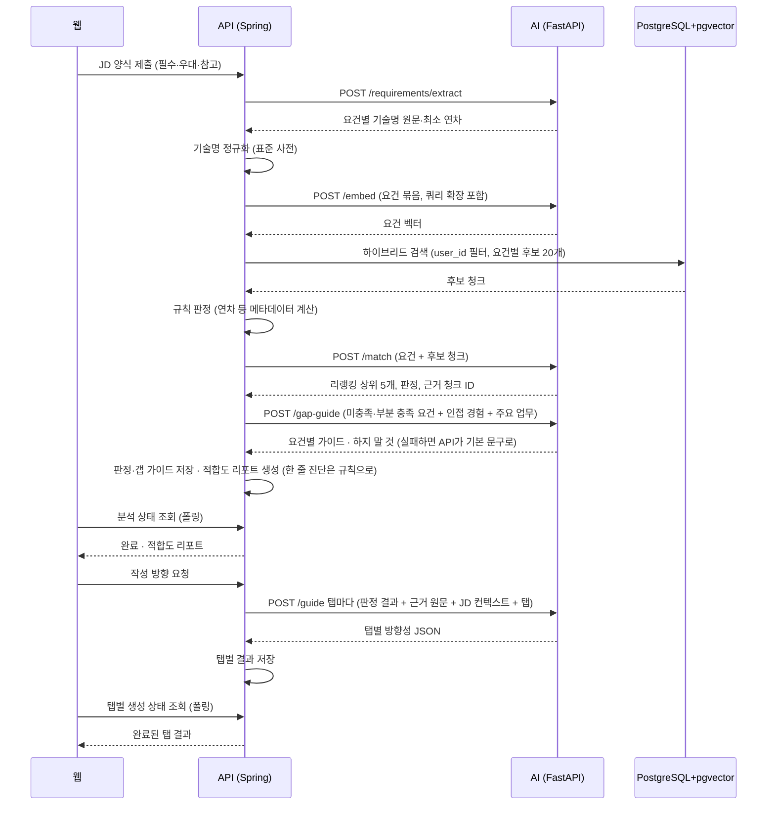

# nerdnam 서비스 기획서

> 서비스명: **nerdnam** · AI 맞춤형 지원서 코치
> 작성일: 2026-10-21 · 수정일: 2026-10-23 · 문서 버전: v1.32

## 목차

1. [개요](#1-개요)
2. [핵심 사용자 흐름](#2-핵심-사용자-흐름)
3. [기능 명세](#3-기능-명세)
4. [데이터 설계](#4-데이터-설계)
5. [시스템 아키텍처](#5-시스템-아키텍처)
6. [화면 구성 (IA)](#6-화면-구성-ia)
7. [출력물 예시](#7-출력물-예시)
8. [비기능 요구사항·리스크](#8-비기능-요구사항리스크)
9. [성공 지표와 로드맵](#9-성공-지표와-로드맵)

### 변경 이력

| 버전 | 날짜 | 내용 |
| --- | --- | --- |
| v1.32 | 2026-10-23 | 웹 ↔ API 계약(C-03) `contracts/web-api.openapi.yaml` 추가 — BE 컨트롤러에서 내보낸 **v0.1.1**(40개 경로·55개 작업). FE 검토를 받아 작성 방향 탭 이름을 응답도 `motive`·`intro`·`portfolio`·`career`·`image`로 통일하고, 응답에서 **꼭 있는 값은 null을 뺐으며**(null이 될 수 있는 필드만 표시), 스키마 이름을 짧게 바꿨다(원래 Java 타입은 `x-java-class`). C-02 화면별 API 목록의 엔드포인트 칸을 모두 채우고, 공통 질문(인증은 쿠키 세션 + CSRF, 오류는 ProblemDetail, AI 작업은 작업 id 폴링)과 S01 동의 순서(소셜 로그인으로 회원·세션이 먼저 생기고 **현재 약관 동의 전에는 서비스 API가 403 CONSENT_REQUIRED**), S08 분석 기록·삭제·재등록 중 근거 표시, S09 `content` ↔ `citations`·리포트 연결, 다시 만들기 피드백 필수, S04 재구성 중 삭제 409를 결정으로 적었다. README에 계약 두 개의 출처·갱신 방법 추가. |
| v1.31 | 2026-10-23 | S10 공고 목록 디자인 추가(`design/apply.html`). 상태별 카드(작성 중·분석 중·분석 실패·분석 완료), 상태에 맞는 이동(작성 중 → S07, 분석 중·실패 → S08, 완료 → S08 리포트·S09 작성 방향), 공고 삭제(확인창, 리포트·분석 기록·작성 방향이 함께 지워짐, 내 경험은 그대로), 공고가 없을 때 안내. 디자인 머리글 "지원 준비" 메뉴를 `apply.html`로. S10 수정. |
| v1.30 | 2026-10-23 | 프로젝트 삭제: 어떤 상태든 S04에서 지울 수 있음(확인창). 확정 프로젝트를 지우면 그 청크를 바로 지우고 매칭에서 빠지며, 이전 분석의 근거는 "삭제된 경험"으로 표시. 기간(월) 입력은 직접 입력 + 달력 고르기, 형식·미래·순서 검사(S03 재직기간은 필수). 경력·프로젝트에서 쓰는 기술은 S02에서 지우지 않고 사용처를 안내(ADR-0002 Q7 화면 동작). F3·S02·S03·S04 수정. |
| v1.29 | 2026-10-23 | "임베딩 대기" 청크 재처리 조건(5.5·8장): `/health`의 모델이 **모두** `ready`일 때 → **`embedding`이 `ready`**일 때. 임베딩은 LLM과 따로 올라가고 LLM 없이도 `/embed`가 동작해(ADR-0001 "AI 서버 `/embed` 확인"), LLM 문제로 벡터 저장까지 멈추지 않게 한다. 생성 작업은 지금처럼 `llm`이 준비되지 않으면 503(`GPU_UNAVAILABLE`). |
| v1.28 | 2026-10-23 | AI 서버 504 추가(5.5 오류 응답): LLM 생성이 AI 서버의 읽기 제한(`LLM_TIMEOUT`) 안에 끝나지 않으면 504를 돌려주고, API는 읽기 시간 초과와 같이 `TIMEOUT`·재시도 안 함으로 처리한다(그 밖의 5xx와 구분). |
| v1.27 | 2026-10-23 | 로컬 테스트 순서(5.5 "GPU 서버 실행"): 먼저 원본 `Qwen/Qwen3.5-4B`(bf16)를 transformers 기반 로컬 서버(AI 레포 `evals/local_llm.py`)로 띄우고, 불러오지 못하거나 너무 느리면 GGUF(llama.cpp `llama-server`)로 바꾼다. v1.24의 llama-server 단독 안내를 대체. |
| v1.26 | 2026-10-23 | AI 이슈(AI-nerdnam #3~#7) 결정 반영. api-ai 계약 v0.1(`contracts/api-ai.openapi.yaml`, 태그 `contracts-v0.1.0`)이 5.5 요청·응답의 기준이 됨: `/restructure` 입력·출력 설명을 계약에 맞춤(`mode` initial·split·episode, 고칠 사례, 확인 질문 `clarifications`), "AI 서버 공통 규칙"은 계약 `info.description`으로도 옮김. 5.3 서빙 인프라의 ADR-0005 상태를 결정으로. 작업목록 C-04·D-7 수정. |
| v1.25 | 2026-10-23 | FE 이슈(FE-nerdnam #2~#7) 결정 반영. 로그인은 Google·카카오 소셜만(이메일 로그인은 MVP 이후, D-8). PDF 내보내기는 브라우저 인쇄(D-6, BE-15 없음). 응답 JSON의 값(판정·상태 등)은 소문자(D-10). 공고를 고쳐 다시 분석하면 분석을 새로 쌓고 화면은 최신, 리포트에서 이전 분석을 볼 수 있음(이력 보기), 작성 방향은 새 분석으로 다시 만듦. S08 사례 근거의 프로젝트가 재등록 중이면 S06의 그 프로젝트 카드로. 3장 공통·S01·S08 수정. |
| v1.24 | 2026-10-23 | 로컬 테스트 방법을 5.5 "GPU 서버 실행"에 추가: Mac에서는 vLLM 대신 OpenAI 호환 서버(llama-server)로 같은 Qwen3.5-4B를 띄워 AI 서버를 `real` 모드로 실행할 수 있다. 로컬 결과는 로직 확인용이고 품질·응답 시간은 GPU 서버에서 잰다. |
| v1.23 | 2026-10-23 | API ↔ AI 호출 방식: API가 AI 작업을 DB에 저장하고 바로 응답, 백그라운드 실행기가 AI를 HTTP(JSON)로 호출, 웹은 폴링. `/guide`는 탭마다 1회 호출하고 SSE를 쓰지 않음(웹은 이미 폴링이라 스트리밍이 필요 없음). 5장 구성도·5.4·5.5 수정, 작업목록 BE-14·BE-18·AI-08·6장 수정. |
| v1.22 | 2026-10-23 | GPU 서빙을 EKS(k8s)·Karpenter·Terraform으로 운영하는 구성 제안(`adr/0005-eks-serving.md`): vLLM과 AI 서버를 한 Pod(vLLM은 네이티브 사이드카, GPU time-slicing), 켜고 끄기는 replicas 0/1(GPU 노드는 Karpenter가 생성·삭제), AI 서버는 클러스터 안 주소와 NetworkPolicy로 API 서버만 접근. 5.3·5.5 수정, ADR-0001 인프라·자동 종료 방식 수정, 작업목록 AI-15·D-11 추가. |
| v1.21 | 2026-10-23 | S05 읽기 모드(확정한 프로젝트 보기)의 머리글은 S06과 같은 앱 머리글("내 경험" 메뉴). 주소는 그대로이고, 웹은 S05만 `(onboarding)` 라우트 그룹 밖 `(review)` 그룹에 두어 상태에 따라 머리글을 고른다. F2·5.2 수정, `design/review.html#confirmed` 머리글 수정. |
| v1.20 | 2026-10-23 | AI 서버 입력 규칙(어기면 422: `/restructure` mode·split 피드백, `/gap-guide` 판정 값, `/guide` 탭 값)과 GPU 서버 실행 정보(포트, `AI_MODE`, 켜는 데 걸리는 시간)를 5.5 "AI 서버 공통 규칙"에 추가. |
| v1.19 | 2026-10-23 | 확정·제외한 사례는 내용을 바꿀 수 없게 정함(F2). 수정 요청·직접 편집·이 버전으로 바꾸기·확인 질문 답변·빼고 진행은 검토 중인 사례에서만 하고, 확정·제외한 사례를 고치려면 "다시 검토하기"로 먼저 되돌린다. 확정 ↔ 제외는 바로 바꿀 수 있다. S05 확정·제외 카드는 읽기 전용. F2·S05 수정. |
| v1.18 | 2026-10-22 | 5.5에 AI 서버 공통 규칙 추가(C-04 전 합의): `/health` 응답 형식(모델별 상태, 모두 ready일 때만 재처리), `/embed` 요청 `items[]`(text·title)·응답(`embedding_model`·`dim`·`vectors`), 가짜 응답(stub) 처리, 오류 응답과 재시도·엔드포인트별 타임아웃(D-7 제안). |
| - | 2026-10-22 | 버전 번호 정리: PR #10(검토 결과 유지 규칙)과 #11(이미지 업로드 제거)이 동시에 v1.14로 올려 번호가 겹쳤다. 머지 순서대로 #10 = v1.14, #11 = v1.15(커밋 메시지에는 v1.14로 남아 있음), #12 = v1.16(커밋 메시지에는 v1.15)으로 다시 매겼다. |
| v1.17 | 2026-10-22 | 확정한 프로젝트를 보는 곳: S05 읽기 모드(확정 사례만, 결정 버튼 없음, "수정" = 재등록 안내). S06 상태별 카드(확정·재등록 중·초안 → S04·검토 중 → S05)와 재등록 안내창, S08 사례 근거 → S05 읽기 모드. F2·S05·S06·S08 수정. |
| v1.16 | 2026-10-22 | AI 서빙 구성 갱신(`adr/0001-gpu-model-serving.md`). LLM을 Qwen3.5-4B로(T4 16GB에서 임베딩과 함께 동작 확인, 품질이 부족하면 9B로), 서빙 인프라는 g4dn.xlarge(T4) 기본. 임베딩은 텍스트만(텍스트 인코더만 로드). GPU 서버가 꺼져 있을 때 AI 작업 상태를 "실패(GPU 서버 꺼짐)"로 기록하고 웹은 상태 조회로 안내, "임베딩 대기"는 AI 서버 `/health`가 준비 완료일 때 재처리. 5장·5.2·5.3·8장 수정. |
| v1.15 | 2026-10-22 | S04 프로젝트 이미지 업로드 제거(`adr/0004-remove-project-image.md`). 올린 이미지를 쓰는 화면·AI 단계가 없어 MVP에서 뺌. F1·9.2 수정, `design/project.html`에서 업로드 칸 삭제. 이미지 설명을 포트폴리오 방향성에 쓰는 안은 추후 후보. |
| v1.14 | 2026-10-22 | S05 검토 결과 유지 규칙(F2): 확정 전 검토 결과는 S04에 들어가거나 S05에서 온보딩 밖으로 나가면 버림(경고 후), S02·S03 다녀오기와 새로고침은 유지, S02·S03에 "검토로 돌아가기"(D-9 결정). ADR-0002 Q5 "다시 나누기 필요" 표시를 이 규칙으로 바꿈. F1·F2·S02·S03·S05 수정. |
| v1.13 | 2026-10-22 | S08 한 줄 진단·갭 대응 가이드를 만드는 곳 결정(`adr/0003-report-diagnosis-gap-guide.md`). 한 줄 진단은 API 규칙(판정 결과로 계산, AI 없음), 갭 대응 가이드는 AI의 새 엔드포인트 `/gap-guide`·프롬프트 P6(미충족·부분 충족만, `/match` 직후, 실패 시 판정별 기본 문구). F5·4.5·5.2·5.4·5.5·5.6·S08·9.3 수정. |
| v1.12 | 2026-10-22 | 다시 나누기·사례 수정 요청의 피드백 반영 규칙을 F2·5.6에 명시(다시 나누기는 피드백 필수, 피드백으로도 원문에 없는 사실은 추가하지 않음). 만족도 평가를 둘로 나눠 화면에 추가: S05 사례 생성 평가(프로젝트마다), S09 방향 제시 평가(공고마다), 5점 별점 + 한 줄 의견. 3장 공통·4.6·S05·S09·9.1 수정. |
| v1.11 | 2026-10-22 | FE 검토 반영. 프로젝트 주소를 `/projects/new`·`/projects/[projectId]`·`/projects/[projectId]/review`로(번호 없는 `/projects`는 S06으로). S05 화면 이름: 결정 취소 → "다시 검토하기", 되돌리기 → 이전 버전을 볼 때 "이 버전으로 바꾸기". **(제안)** 공고 목록을 MVP로(S10 중 목록만, "지원 준비" 메뉴 = `/apply`). **(제안)** 웹↔API의 AI 작업 결과는 모두 작업 상태 조회(폴링)로 받음(작성 방향 SSE 중계 대신). 3장 공통·F2·5장·S05·S10·8장·9장 수정. |
| v1.10 | 2026-10-22 | 프로젝트 등록·사례 재구성 규칙 결정(`adr/0002-project-registration-rules.md`). 생성 횟수 상한 n 제거, 확정 후 수정은 등록 과정 전체를 다시 거치는 재등록으로(기존 내용은 맥락으로 유지), 나눈 뒤 원문 수정 시 다시 나누기 필요, 결정 취소, 기술·경력 삭제 규칙, 연차 합집합 계산(경력만), 판정 결합은 낮은 쪽. 2장·F1·F2·F3·4.3·4.4·5.4·5.5·S05·S06·8장·9장 수정. 부분 다시 나누기·회차 비교를 추후 개발로 기록. |
| v1.9 | 2026-10-22 | GPU·모델 서빙 구성 제안(`adr/0001-gpu-model-serving.md`). 임베딩 모델을 embeddinggemma-2로, LLM·임베딩 모두 AWS GPU 서버에서 vLLM 등으로 자체 서빙(사용할 때만 켬)하도록 5장 아키텍처·5.3 기술 구성·8장 리스크 수정. 외부 LLM API 표현 제거. |
| v1.9 | 2026-10-21 | 새 공고 입력 화면 주소를 `/apply/new/jd`로 확정(공고 id `new`는 예약어). 저장된 공고 수정은 `/apply/[jdId]/jd`. 5.2 웹 레포 구조에 `jd` 추가. |
| v1.8 | 2026-10-21 | 서비스명을 nerdnam으로 확정. 레포 이름을 `nerdnam-web`·`nerdnam-api`·`nerdnam-ai`·`nerdnam-docs`로, Java 패키지를 `com.nerdnam`으로 변경. |
| v1.7 | 2026-10-21 | LLM을 Qwen3.5-9B(자체 서빙)로 확정해 5.3 기술 스택과 비용 위험 항목 수정. 담당별 작업 목록(`작업목록.md`) 추가. |
| v1.6 | 2026-10-21 | 복사가 막힌 공고가 많아 JD 입력을 고정 양식 직접 입력으로 변경(F4). AI 원문 분리와 분리 상태 화면 제거, 입력 검증 메시지 추가. AI는 적합도 분석 시 요건별 기술명·연차만 추출(`/requirements/extract`). |
| v1.5 | 2026-10-21 | JD 분리를 버튼을 눌렀을 때만 하도록 변경(F4). 분리 방식(규칙+LLM+원문 검증), 기술명 정규화는 API가 담당, S07 상태별 화면과 실패 메시지 표 추가. |
| v1.4 | 2026-10-21 | 온보딩 중 기술스택·경력·프로젝트 단계로 돌아가 수정·추가하는 규칙(F1) 추가. 단계 표시의 완료 단계를 링크로 바꾸고, 프로젝트 입력 화면에 경력·기술스택 바로가기 추가. |
| v1.3 | 2026-10-21 | 프로젝트를 사례(에피소드) 여러 개로 나누고 사례별로 확정·제외하도록 F2, 4.3, 5.5, S05·S06, KPI 변경. 프로젝트 확정 조건, 다시 나누기, 사례 직접 추가 추가. |
| v1.2 | 2026-10-21 | 기술스택에서 사용 기간·최근 사용 연도 제거(연차는 경력 재직기간으로 계산). 숙련도 3단계 이름을 "능숙"으로 바꾸고 단계별 기준 추가. 프로젝트 입력에 사용 기술 추가. 프로젝트 입력 화면의 AI 보충 질문·작성 체크를 없애고, 빠진 정보 질문은 재구성 단계(F2)로 일원화. |
| v1.1 | 2026-10-21 | API 서버를 Spring으로, AI 기능을 FastAPI로 분리. RAG 데이터의 등록·조회 책임을 API 서버로 이동. 멀티 레포 구성과 서버 간 계약 관리 방식 추가. 기능별 담당 표기. |
| v1.0 | 2026-10-21 | 최초 작성 |

---

## 1. 개요

**한 줄 정의:** 내 기술스택·경력·프로젝트를 한 번 정리해 두면, 지원하려는 채용공고(JD)마다 지원동기·자기소개·포트폴리오·경력기술서를 어떻게 써야 할지 방향을 잡아 주는 AI 지원서 코치입니다.

### 배경과 문제

- **공고마다 처음부터 다시 쓴다.** 같은 경험이라도 회사마다 강조점이 달라, 지원서 1건에 수 시간이 든다.
- **경험이 나열식이다.** "~을 개발했다" 위주로 적혀 문제 해결 과정과 성과가 드러나지 않는다.
- **범용 챗봇은 맥락이 끊긴다.** 매번 이력을 붙여넣어야 하고, 없는 경험이나 수치를 지어낼 위험이 있다.

### 해결 방향

1. **경험 자산화** — 프로젝트를 [문제]-[해결]-[결과] 구조로 한 번 정리하고, 사용자 확인을 거친 내용만 저장한다.
2. **JD 근거 매칭** — 필수·우대 요건마다 저장된 경험 중 근거가 되는 것을 찾아 연결한다.
3. **방향성 코칭** — 완성 원고가 아니라 "무엇을, 어떤 순서로, 어떤 근거로 쓸지"를 제시해 사용자가 자기 목소리로 쓰게 한다.

### 목표 (MVP 기준)

- 첫 정보 입력부터 저장까지 15분 이내 완료
- JD 입력 후 방향성 결과 60초 이내 표시
- 결과에 쓰인 모든 경험 근거가 사용자 저장 데이터로 추적 가능 (출처 없는 경험 언급 0건)

### 타깃 사용자

| 세그먼트 | 특징 | 핵심 니즈 |
| --- | --- | --- |
| 이직 준비 1~7년차 개발자 (주 타깃) | 경력·프로젝트가 쌓였지만 정리가 안 됨 | 공고별로 빠르게 강조점 바꾸기 |
| 신입·부트캠프 수료생 | 경력 대신 프로젝트 중심 | 프로젝트를 성과 중심으로 표현하기 |
| 다수 기업 동시 지원자 | 주 5건 이상 지원 | 지원서 작성 시간 단축 |

기술스택 입력 양식이 있는 만큼 첫 타깃은 IT 직군으로 가정했습니다. 다른 직군으로 넓힐 때는 기술스택 양식을 "직무 역량" 양식으로 일반화합니다.

---

## 2. 핵심 사용자 흐름

서비스는 처음 한 번 하는 **내 경험 정리**와 공고마다 반복하는 **공고별 지원 준비**, 두 영역으로 돌아갑니다. 두 영역을 잇는 것은 RAG 저장소입니다.



AI는 프로젝트 하나를 여러 사례(에피소드)로 나누고, 사용자는 사례마다 확정하거나 제외합니다. 마음에 들지 않는 사례는 횟수 제한 없이 다시 만들 수 있고, 확정한 사례만 저장되어 이후 모든 공고의 근거로 쓰입니다. 확정한 프로젝트를 고치려면 ①의 입력 → 나누기 → 사례별 결정 → 확정을 다시 거치며(재등록), 이전 내용은 맥락으로 남습니다.

---

## 3. 기능 명세

기능은 사용자 흐름에 따라 F1~F6 여섯 단계로 나뉩니다. P1은 MVP 필수, P2는 MVP 이후 추가입니다. 담당은 해당 기능의 주 구현 주체입니다(웹 = 프론트엔드, API = Spring 서버, AI = FastAPI 서버).

| ID | 기능 | 핵심 내용 | 담당 | 우선순위 |
| --- | --- | --- | --- | --- |
| F1 | 사용자 정보 수집 | 기술스택·경력은 양식, 프로젝트는 자유 텍스트 | 웹 · API | P1 |
| F2 | 프로젝트 재구성·사례별 확정 | 프로젝트를 사례(에피소드) 여러 개로 나누고 사례마다 [문제]-[해결]-[결과] 변환, 사례별 확정·제외 | AI(변환) · API(버전·상태) · 웹 | P1 |
| F3 | 임베딩·RAG 저장 | 확정한 사례와 기술·경력만 청크 단위로 저장 | API(청크·저장) · AI(임베딩) | P1 |
| F4 | JD 입력 | 고정 양식에 필수·우대·주요 업무·회사 소개 직접 입력, 요건별 기술명·연차 추출 | 웹(양식) · API(저장·정규화) · AI(요건 정보 추출) | P1 |
| F5 | 매칭·방향성 제시 | 요건별 근거 검색, 적합도 리포트, 산출물 4종 방향성 | API(검색) · AI(판정·생성) · 웹 | P1 |
| F6 | 포트폴리오 이미지 프롬프트 | 시각자료가 필요한 항목에 이미지 생성 프롬프트 작성 | AI · 웹 | P1 |

### F1. 사용자 정보 수집

- **기술스택 (양식):** 카테고리(언어/프레임워크/DB/인프라/협업도구) → 기술명(자동완성) → 숙련도 4단계.
    - 숙련도는 사용자가 헷갈리지 않도록 단계마다 기준 문장을 함께 보여준다 (4.1 참고).
    - 사용 기간은 받지 않는다. 연차 조건은 경력의 재직기간과, 경력·프로젝트에 연결된 사용 기술로 계산한다.
    - 기술명은 표준 사전으로 정규화한다 (예: react.js, 리액트 → React). JD 용어와 매칭 정확도를 높이기 위함. 사전은 API 서버가 하나만 관리하고, 기술스택 자동완성과 JD 기술명 정규화에 같이 쓴다.
- **경력 (양식):** 회사명, 부서·직무, 직급, 고용형태, 재직기간(재직 중 선택 가능), 주요 업무(최대 5줄), 사용 기술(기술스택에서 선택).
- **프로젝트 (자유 텍스트):** 제목, 기간, 소속(경력 연결 또는 개인·팀), **사용 기술**, 본문, 링크(GitHub·배포 URL). 이미지 업로드는 받지 않는다(ADR-0004).
    - 사용 기술은 기술스택에서 고르고, 없는 기술은 바로 추가한다. 새로 추가한 기술은 기술스택에도 "학습 중"으로 저장된다.
- **작성 가이드:** 프로젝트 입력 화면은 AI를 호출하지 않는다. 문제·해결 방법과 이유·역할·결과 수치를 적도록 고정된 안내만 보여준다. 빠진 정보는 F2 재구성 단계에서 `확인 필요` 질문으로 받는다.
- **이전 단계로 돌아가 수정·추가:** 온보딩 중 이미 거친 단계(기술스택·경력·프로젝트)는 단계 표시에서 "수정" 링크로 바로 돌아갈 수 있다. 프로젝트 입력 화면에도 소속 옆에 "경력 추가·수정", 사용 기술 안내에 "기술스택 화면" 링크를 둔다.
    - 단계를 옮길 때 입력 내용은 자동 저장되고, 돌아온 화면의 상태(작성 중인 프로젝트)는 그대로 유지된다. 단, 확정 전 S05 검토 결과(사례별 결정 등)는 F2의 "검토 결과 유지 규칙"을 따른다.
    - 온보딩을 마친 뒤에는 S06 내 경험 라이브러리의 "편집"으로 같은 화면에 들어간다. 확정한 프로젝트의 "편집"은 재등록(F2)으로 들어간다.
    - 이미 확정한 사례에 연결된 기술·경력을 수정하면, 해당 청크만 다시 임베딩한다(F3). 사례 내용 자체는 바뀌지 않으므로 다시 확정할 필요는 없다.
    - 경력·프로젝트에서 쓰는 기술은 기술스택에서 지울 수 없고, 어디서 쓰는지 안내한다(예: "OO 경력에서 사용 중"). 프로젝트가 연결된 경력도 지울 수 없고, 프로젝트 소속을 개인으로 바꾸도록 안내한다.
- **(P2) 이력서 가져오기:** 기존 이력서 PDF를 파싱해 양식을 자동으로 채운다.

### F2. 프로젝트 재구성·사례별 확정

한 프로젝트 안에는 서로 다른 문제 해결 이야기가 여러 개 들어 있을 수 있고, 각각 다른 JD 요건에 매칭됩니다. 그래서 프로젝트를 **사례(에피소드)** 단위로 나눠 다룹니다. 화면에서는 "사례", 데이터와 문서에서는 "에피소드"라고 부릅니다.

- **나누기:** AI 서버가 본문을 사례 N개로 나누고, 사례마다 제목, [문제]-[해결]-[결과], 메타정보(역할, 사용 기술, 정량 성과), 원문에서 근거가 된 구간을 만든다. AI 서버는 상태 없이 변환만 하고, 버전·횟수·상태는 API 서버가 관리한다.
- **원문에 없는 사실은 생성하지 않는다.** 빈 곳은 사례마다 `확인 필요`로 표시하고 질문한다 (예: "응답 속도 개선 수치가 있나요?"). 두 사례의 결과가 겹쳐 보이면 그것도 질문한다. 사용자가 답하면 그 답을 원문에 덧붙여 해당 사례의 다음 버전을 만든다. 빠진 정보에 대한 질문은 이 단계에서만 한다.
- **사례별 선택지:** **확정** / **제외**(저장하지 않음) / **수정 요청**(자연어 피드백) / **직접 편집** / **되돌리기**(이전 버전으로. 화면에서는 이전 버전을 볼 때만 "이 버전으로 바꾸기" 버튼으로 보이고, 사례 상태는 바뀌지 않음) / **결정 취소**(확정·제외를 검토 중으로, 프로젝트 확정 전까지. 화면 이름 "다시 검토하기"). `확인 필요`가 남은 사례는 확정할 수 없다. `확인 필요` 질문은 답하거나 "빼고 진행"할 수 있고, 빼고 진행하면 그 내용을 뺀 새 버전을 AI 호출 없이 만든다.
    - **확정·제외한 사례는 내용을 바꿀 수 없다.** 수정 요청·직접 편집·이 버전으로 바꾸기·`확인 필요` 답변·빼고 진행은 검토 중인 사례에서만 할 수 있다. 확정·제외한 사례를 고치려면 먼저 "다시 검토하기"로 검토 중으로 되돌리고, 고친 뒤 다시 확정한다. 확정한 사례 내용이 바뀌면 `확인 필요`가 다시 생길 수 있어(이전 버전으로 바꾸거나 수정 요청 결과에 질문이 붙는 경우) "확인 필요가 남은 사례는 확정할 수 없다"는 규칙이 깨지기 때문이다. 확정 ↔ 제외는 내용이 바뀌지 않으므로 바로 바꿀 수 있다.
- **프로젝트 단위 선택지:** **다시 나누기**(사례 구분 방식에 대한 피드백, 예: "두 사례를 합쳐 줘") / **사례 직접 추가**(AI가 놓친 사례).
- **피드백 반영:** 다시 나누기와 사례 수정 요청은 사용자가 쓴 피드백을 AI 재구성 요청(`/restructure`)에 함께 보내고, AI는 그 피드백을 반영해 사례를 새로 만든다. 다시 나누기는 피드백 없이 누를 수 없다. 피드백은 사례를 나누고 합치는 방식과 표현에만 반영하며, 피드백으로 요청해도 **원문에 없는 사실(수치·경험)은 추가하지 않는다.** 사실을 보태려면 확인 질문에 답하거나 직접 편집한다.
- 사례마다 버전(v1, v2 …)을 따로 남겨 이전 버전으로 되돌릴 수 있다. 다시 나누기를 하면 사례 구성이 바뀌므로 모든 사례의 결정이 초기화되고, 이전 사례는 지우지 않고 기록으로만 남긴다.
- 나누기·다시 나누기·사례 수정 요청·확인 질문 반영은 **횟수 제한이 없다.** 생성 횟수는 통계·비용 측정용으로만 기록한다.
- **검토 결과 유지 규칙:** S05의 검토 결과(사례, 사례별 결정, 확인 질문 답변, 수정 요청으로 만든 버전)는 **프로젝트를 확정해야 남는다.** 확정 전에는 아래처럼 다룬다.

| 상황 | 검토 결과 |
| --- | --- |
| S05에서 프로젝트 확정 | 확정한 사례만 저장 (F3) |
| **S04(원문 화면)에 들어감** (S05의 "원문 수정", 단계 표시, S03의 "다음" 등 어느 경로든) | **버린다.** 들어가기 전에 "지금 들어가면 검토한 내용이 사라져요" 경고 |
| S05에서 온보딩 밖(라이브러리, 지원 준비 등)으로 나감 | **버린다.** 나가기 전에 같은 경고 |
| S05 → S02·S03 다녀오기 (빠진 기술·경력 보충) | 유지. 원문이 그대로라 사례가 틀어지지 않는다. S02·S03의 "다음" 자리에 **"검토로 돌아가기"**를 보여 준다 |
| S02·S03에서 온보딩 밖으로 나감 | 유지. 다음에 S04에 들어갈 때 버린다 |
| S05에서 새로고침 | 유지 |

- 그래서 S05는 항상 지금 원문으로 나눈 결과만 보여 주고, "원문은 바뀌었는데 사례는 옛 원문 기준"인 상태가 생기지 않는다. S04에서 원문을 고친 뒤 "재구성하기"를 누르면 바뀐 원문으로 새로 나눈다(피드백 필요 없음, 첫 나누기와 같다). S05의 "다시 나누기"는 원문은 그대로 두고 나누는 방식을 바꿀 때 쓴다(피드백 필수).
- 버린 결과는 화면에 다시 나오지 않는다. 통계(9.1 KPI)용 기록을 남길지는 API 서버가 정한다.
- 재등록(아래) 중이면 버리는 것은 이번 검토 결과뿐이고, 이전에 확정한 사례는 그대로 검색에 쓰인다.
- **상태:** 사례는 `검토 중` → `확정` 또는 `제외`. 프로젝트는 `초안` → `검토 중` → `확정`이며, **모든 사례를 결정하고 확정한 사례가 1개 이상일 때만** 프로젝트를 확정할 수 있다. 확정한 사례만 F3로 넘어간다.
- **재등록 (확정 후 수정):** 확정한 프로젝트를 고치려면 등록 과정 전체를 다시 거친다. 프로젝트는 `초안`으로 돌아가고 기존 원문·사용 기술·링크·확인 질문 답변이 채워진 입력 화면부터 시작한다. 이전 사례와 버전은 기록으로 남고, 다시 나누기 때 이전 확정 사례를 AI에 맥락으로 보낸다. 다시 확정하기 전까지 이전 확정 사례는 검색에 계속 쓰인다.
- **확정한 프로젝트 보기 (읽기 모드):** 확정한 프로젝트는 S05를 읽기 모드로 연다. 원문 하이라이트와 **확정한 사례만** 보여 주고, 확정·제외·수정 요청·다시 나누기·확인 질문·버전 바꾸기는 없다. 고치려면 "수정"(재등록 안내 → S04). 확정 전 검토 결과가 없으므로 나갈 때 경고도 없다. 사례 생성 평가는 그대로 보여 준다(언제든 바꿀 수 있음). 머리글은 온보딩용("저장하고 나중에 하기")이 아니라 S06과 같은 앱 머리글("내 경험" 메뉴)을 쓴다.
- (추후 개발) 마음에 들지 않는 사례만 다시 만드는 **부분 다시 나누기**와, 이전 사례를 남긴 채 새 사례를 만들어 나란히 보는 **회차 비교**는 MVP 이후로 미룬다 (9.2).

### F3. 임베딩·RAG 저장

- 프로젝트 확정 시점에 API 서버가 실행하며, 확정한 사례만 등록하고 제외한 사례는 등록하지 않는다. 기술스택·경력은 저장 즉시 등록한다.
- 재등록한 프로젝트를 다시 확정하면 그 프로젝트의 청크(episode, project_summary)를 새로 확정한 사례 기준으로 통째로 바꾼다.
- **프로젝트를 삭제하면** 그 프로젝트의 청크(episode, project_summary)를 바로 지워 다음 분석부터 근거로 쓰지 않는다. 이전에 끝난 분석의 근거는 표시 이름만 남기고 "삭제된 경험"으로 보여 준다(원본으로 갈 곳이 없음).
- API 서버가 데이터를 의미 단위 청크로 나누고(4장), AI 서버에서 임베딩 벡터를 받아 PostgreSQL(pgvector)에 저장한다. 수정된 항목의 청크만 다시 등록하고 이전 버전 청크는 삭제한다.
- 벡터는 사용자별로 격리해 다른 사용자의 경험이 검색되지 않게 한다. 검색 시 user_id 필터는 API 서버가 항상 건다.

### F4. JD 입력

복사가 막힌 채용공고가 많아서, 원문을 붙여넣고 AI가 나누는 방식 대신 **고정 양식에 사용자가 직접 옮겨 적는 방식**으로 받습니다. 공고 원문 전체는 받지 않습니다.

| 항목 | 필수 | 입력 방식 | 쓰임 |
| --- | --- | --- | --- |
| 회사명 | O | 한 줄 | 결과 표시, 지원동기 |
| 포지션 | O | 한 줄 | 결과 표시, 지원동기 |
| 공고 링크 | - | URL (나중에 다시 보기용, 수집하지 않음) | 기록 |
| 필수사항 | O (1개 이상) | 한 줄에 요건 하나인 목록 | 적합도 판정 |
| 우대사항 | - | 한 줄에 요건 하나인 목록 | 적합도 판정 |
| 주요 업무 | - | 한 줄에 업무 하나인 목록 | 지원동기 (임베딩·판정에 쓰지 않음) |
| 회사 소개·인재상 | - | 자유 텍스트 | 지원동기 (임베딩·판정에 쓰지 않음) |

- **입력 편의:** Enter를 누르면 아래에 새 줄이 생긴다. 여러 줄을 한 번에 붙여넣으면(복사가 되는 공고의 경우) 줄마다 나눠 넣고, 앞의 목록 기호(-, •, 1.)는 지운다. 이 처리는 웹에서 규칙으로 하며 AI를 쓰지 않는다.
- **작성 가이드:** 한 줄에 요건 하나, 공고 문구를 그대로, 연차는 숫자로("3년 이상"). 잘못된 예와 바른 예를 화면에 함께 보여준다.
- **임시 저장:** 입력 중인 내용은 자동으로 임시 저장한다.
- **요건 정보 추출 (AI, 적합도 분석 시작 시):** 사용자가 "적합도 분석하기"를 누르면 API가 요건 줄 목록을 AI 서버에 보내, 줄마다 기술명 원문(`skills_raw`)과 최소 연차(`min_years`)만 뽑는다. 사용자가 쓴 문구를 바꾸거나 나누거나 필수·우대를 바꾸지 않는다.
- **기술명 정규화는 API 서버가 한다.** AI가 돌려준 `skills_raw`를 S02와 같은 표준 기술 사전으로 바꾼다. 사전에 없는 기술명은 원문 그대로 두고 기록해 사전 보강에 쓴다.
- (P2) 공고 이미지를 올리면 OCR로 양식을 미리 채워 주는 기능. 복사가 막힌 공고를 위한 확장이다.

**S07 입력 검증과 메시지**

검증 메시지는 "적합도 분석하기"를 처음 눌렀을 때부터 보여주고, 그 뒤로는 고칠 때마다 바로 갱신한다.

| 상황 | 메시지 | 위치 |
| --- | --- | --- |
| 회사명 비어 있음 | 회사명을 입력해 주세요. | 회사명 칸 아래 |
| 포지션 비어 있음 | 포지션을 입력해 주세요. | 포지션 칸 아래 |
| 필수사항 0개 | 필수사항을 1개 이상 입력해 주세요. | 필수사항 목록 아래 |
| 한 줄이 150자 초과 | 한 줄이 너무 길어요. 요건이 여러 개라면 줄을 나눠 주세요. (150자 이하) | 해당 줄 아래 |
| 같은 목록 안 중복 | 같은 내용이 이미 있어요. | 해당 줄 아래 |
| 위 오류가 하나라도 있음 | 고쳐야 할 항목이 N개 있어요. 빨간색으로 표시된 곳을 확인해 주세요. | 화면 위 요약 |
| 요건 정보 추출 실패 (AI 오류·시간 초과) | 분석을 시작하지 못했어요. 입력한 내용은 그대로 남아 있으니 잠시 후 다시 시도해 주세요. | S07 화면 위, 다시 시도 버튼 |

빈 줄은 오류로 보지 않고 저장할 때 무시한다.

### F5. 매칭·방향성 제시

- 요건 항목마다 RAG 검색 → 근거 경험 상위 k개 → `충족` / `부분 충족` / `미충족` 판정과 근거 출처를 붙인다.
- **적합도 리포트:** 필수 충족률, 우대 충족률, 미충족 항목(갭) 목록, **한 줄 진단**(판정 결과로 API가 규칙으로 만드는 요약 문장, AI 없음).
- **산출물 4종 방향성:** 지원동기 / 자기소개 / 포트폴리오 / 경력기술서. 각각 핵심 메시지, 문단 구성, 사용할 경험(출처), 강조 키워드, 피해야 할 표현을 담는다.
    - 자기소개: 요건별로 어느 문단이 다루는지 보여주는 **요건 커버리지** 포함
    - 포트폴리오: 대표 프로젝트의 **페이지 흐름**(쪽별 내용과 제작 도구) 포함
    - 경력기술서: 기존 업무 표현을 공고 용어로 바꾼 **바꿔 쓰기 표**와 미리보기 포함
- **갭 대응 가이드:** 미충족 요건은 인접 경험으로 연결하는 방법과, 학습 중임을 정직하게 쓰는 방법을 제시한다. 없는 경험을 있는 것처럼 쓰도록 권하지 않는다. 미충족·부분 충족 요건마다 가이드 문장과 "하지 말 것" 문장을 AI(`/gap-guide`, P6)가 판정 직후에 만들고, 실패하면 판정별 기본 문구로 대신한다. 작성 방향(P4)은 이 가이드를 입력으로 받아 S08과 어긋나지 않게 한다 (ADR-0003).

### F6. 포트폴리오 이미지 프롬프트

- 포트폴리오 방향성 중 시각자료가 효과적인 항목을 고른다: 시스템 아키텍처, Before/After 비교, 서비스 화면 목업, 커버 이미지.
- 항목마다 목적, 구성 요소, 스타일, 비율, 네거티브 프롬프트를 담은 영문 프롬프트와 한글 설명을 만든다. 포트폴리오의 몇 쪽에 쓰이는지 함께 표시한다.
- 실제 수치가 들어가는 그래프나 정확한 텍스트가 필요한 도식은 이미지 생성 대신 차트·다이어그램 도구를 권한다. 생성 이미지는 숫자와 글자를 왜곡하기 쉽기 때문이다.

### 공통 기능

- 결과 히스토리(공고별 저장)와 공고 목록(머리글 "지원 준비" 메뉴, `/apply`), 복사·PDF 내보내기(P1)
    - **PDF 내보내기는 브라우저 인쇄**로 한다(D-6). 웹이 인쇄용 화면 모양을 정하고, 사용자는 인쇄 창에서 "PDF로 저장"을 고른다. 서버에서 PDF를 만들지 않는다.
    - **다시 분석:** 공고를 고쳐 다시 분석하면 이전 분석을 덮어쓰지 않고 새로 쌓는다. 리포트는 가장 최근 분석을 보여 주고(분석일도 최신), 이전 분석은 리포트의 "분석 기록"에서 골라 볼 수 있다. 작성 방향은 분석에 묶여 있어 새 분석으로 다시 만든다(탭을 열 때).
- 만족도 평가(P1): S05 **사례 생성 평가**(프로젝트마다 한 번)와 S09 **방향 제시 평가**(공고마다 한 번)를 따로 받는다. 5점 별점과 한 줄 의견(선택), 언제든 바꿀 수 있고 마지막 값만 남는다. 9.1 KPI에 쓴다.
- 지원 현황 관리(지원일, 전형 단계), 여러 공고 간 요건 비교(P2, 공고 목록을 키워 S10으로)

---

## 4. 데이터 설계

모든 데이터는 **API 서버가 관리하는 PostgreSQL 하나**에 저장합니다. 원본은 `app` 스키마, 검색용 청크와 벡터는 `rag` 스키마(pgvector)에 두며, 마이그레이션은 API 서버의 Flyway에서만 실행합니다. AI 서버는 DB에 접근하지 않습니다.

프로젝트는 하나의 묶음이 아니라 **[문제]-[해결]-[결과] 에피소드 단위**로 자르는 것이 핵심입니다. 한 프로젝트 안에서도 성능 개선과 운영 절차 개선은 서로 다른 JD 요건에 매칭되기 때문입니다. 에피소드는 화면에서 "사례"로 표시합니다.

### 4.1 기술스택 양식

| 필드 | 타입 | 필수 | 예시 |
| --- | --- | --- | --- |
| category | enum | O | language, framework, database, infra, tool |
| name | string(표준 사전) | O | Spring Boot |
| level | 1~4 | O | 3 |

| 숙련도 | 이름 | 기준 |
| --- | --- | --- |
| 1 | 학습 중 | 공부했거나 개인 프로젝트에서 써 봤다 |
| 2 | 실무 사용 | 업무에서 써 봤고, 막히면 찾아보며 해결한다 |
| 3 | 능숙 | 설계부터 문제 해결까지 혼자 할 수 있다 |
| 4 | 전문가 | 팀의 기준을 정하고 다른 사람을 가르친다 |

### 4.2 경력 양식

| 필드 | 타입 | 필수 | 예시 |
| --- | --- | --- | --- |
| company | string | O | OO커머스 |
| team / job_title | string | O | 결제플랫폼팀 / 백엔드 개발자 |
| position | string | - | 선임 |
| employment_type | enum | O | 정규직, 계약직, 인턴, 프리랜서 |
| start / end | YYYY-MM | O | 2023-03 / null(재직 중) |
| duties | string[] (최대 5) | O | 결제 API 설계·운영 |
| skills | skill_id[] | - | Spring Boot, Kafka |

### 4.3 재구성된 프로젝트 구조

```json
{
  "project_id": "p_102",
  "title": "결제 승인 API 성능 개선",
  "period": { "start": "2024-05", "end": "2024-09" },
  "career_id": "c_01",
  "skills": ["Spring Boot", "Redis", "Kafka"],
  "status": "confirmed",
  "generation_count": 2,
  "episodes": [
    {
      "episode_id": "e_201",
      "title": "결제 승인 응답 지연 개선",
      "status": "confirmed",
      "version": 2,
      "role": "백엔드 리드 (팀 4명)",
      "skills": ["Spring Boot", "Redis", "Kafka"],
      "problem": "프로모션 기간 결제 승인 응답이 평균 1.2초까지 느려져 이탈 발생",
      "solution": "가맹점 조회를 Redis 캐시로 전환, 승인 후처리를 Kafka 비동기로 분리",
      "result": "평균 응답 1.2초 → 0.3초, 피크 TPS 약 2배 처리",
      "metrics": [{ "name": "평균 응답시간", "before": "1.2s", "after": "0.3s", "source": "raw_text" }],
      "source_spans": [[0, 182]],
      "unverified": []
    },
    {
      "episode_id": "e_202",
      "title": "프로모션 전 부하 테스트 절차 도입",
      "status": "excluded",
      "version": 1,
      "role": "절차 설계·문서화",
      "skills": [],
      "problem": "프로모션 트래픽을 미리 확인할 방법이 없어 문제를 운영 중에야 발견",
      "solution": "실제 트래픽 패턴의 부하 테스트 절차와 장애 대응 매뉴얼을 만들어 팀에 공유",
      "result": "다음 프로모션 피크를 문제없이 넘김",
      "metrics": [],
      "source_spans": [[183, 290]],
      "unverified": []
    }
  ],
  "raw_text": "(사용자 원문 보관)"
}
```

- `status`(에피소드): `review` | `confirmed` | `excluded` | `superseded`(다시 나누기로 대체됨, 화면에 보이지 않고 기록으로만 남음). 프로젝트 `status`는 모든 에피소드가 `confirmed`나 `excluded`이고 `confirmed`가 1개 이상일 때만 `confirmed`가 될 수 있다.
- `version`은 에피소드마다 따로 올라간다. 이전 버전은 별도 이력 테이블에 보관한다.
- `generation_count`는 프로젝트 단위 AI 생성 누적 횟수(나누기 + 다시 나누기 + 사례 수정 요청)다. 상한은 없고 통계·비용 측정용이다.
- `split_round`(나누기 회차, 첫 나누기 = 1)를 프로젝트와 에피소드에 기록해, 어느 회차에서 나온 사례인지 구분한다 (재등록 맥락, 추후 회차 비교용).
- `source_spans`: 원문에서 이 에피소드의 근거가 된 구간(문자 위치). S05 화면의 원문 하이라이트에 쓴다.
- `unverified`: LLM이 추정했지만 사용자가 확인하지 않은 내용. 비어 있어야 에피소드를 `confirmed`로 바꿀 수 있다.
- `raw_text`는 항상 보관해 재구성 재시도와 사실 검증의 기준으로 쓴다. 확인 질문에 대한 답도 원문에 덧붙여 보관한다.

### 4.4 벡터 청크 설계 (`rag` 스키마)

| 청크 유형 | 단위 | 임베딩 텍스트 구성 |
| --- | --- | --- |
| skill | 기술 1개 | 기술명 · 카테고리 · 숙련도 기준 문장 · 사용처(경력·프로젝트명) |
| career | 경력 1건 | 회사 · 직무 · 기간 · 주요 업무 · 사용 기술 |
| project_summary | 프로젝트 1건 | 제목 · 역할 · 기술 · 확정한 에피소드별 한 줄 요약 |
| episode | 확정한 에피소드 1개 | 프로젝트 제목 + 에피소드 제목 + 역할 + 문제 + 해결 + 결과 |

- **공통 메타데이터:** user_id, chunk_type, source_id, skills[], period, months(경력·프로젝트 기간), has_metric, version, **embedding_model**.
- 메타데이터는 필터로 쓴다. 예: "3년 이상" 요건 → 요건 기술을 쓴 경력의 재직기간 합산(겹치는 기간은 한 번만, 개인·팀 프로젝트 기간은 제외), "성과 중심" 검색 → has_metric = true 우선.
- `embedding_model`을 청크마다 저장해, 모델을 바꿀 때 재임베딩 대상을 찾을 수 있게 한다.

### 4.5 JD 구조

| 필드 | 설명 |
| --- | --- |
| jd_id, company, position | 기본 정보 |
| requirements[] | id, type(required/preferred), text(원문), skills[](정규화), min_years |
| context | 주요 업무, 회사 소개, 인재상 (지원동기용, 임베딩하지 않음) |
| match_results[] | requirement_id, verdict, evidence_chunk_ids[], reason, (미충족·부분 충족만) gap_guide{advice, avoid, cited_chunk_ids[], source: ai/fallback} |

- **공고 id `new`는 쓰지 않는다.** 웹은 새 공고 입력 화면을 `/apply/new/jd`로 쓰므로, API 서버가 만드는 jd_id가 `new`가 되면 안 된다.

### 4.6 만족도 평가

| 필드 | 설명 |
| --- | --- |
| target_type | `episode_generation`(S05 사례 생성 평가) / `guide`(S09 방향 제시 평가) |
| target_id | project_id 또는 jd_id |
| score | 1~5 |
| comment | 한 줄 의견, 없을 수 있음 |
| updated_at | 마지막으로 바꾼 시각 |

- 사용자·대상마다 하나만 둔다(다시 평가하면 덮어씀). 평가할 때의 생성 회차(`split_round` 등)를 함께 남기면 피드백 전후 비교에 쓸 수 있다.

---

## 5. 시스템 아키텍처

서비스는 **웹(Next.js) · API(Spring) · AI(FastAPI)** 세 서버로 나뉘고, 각각 별도 레포지토리에서 개발합니다. 호출 방향은 **웹 → API → AI** 한 줄로 고정합니다. 인증, 데이터 저장, 사용자별 격리는 API 서버 한 곳이 책임지고, AI 서버는 DB 없이 요청을 받아 결과만 돌려주는 상태 없는 서버로 둡니다.



### 5.1 서버별 책임

| 구분 | 웹 (Next.js) | API (Spring) | AI (FastAPI) |
| --- | --- | --- | --- |
| 역할 | 화면, 입력 검증, AI 작업 진행 상태 표시 | 인증, 도메인 로직, 데이터 저장, AI 호출 조율 | LLM·임베딩을 쓰는 변환·판정·생성 |
| 호출 대상 | API 서버만 | AI 서버, PostgreSQL, Redis | 자체 서빙하는 LLM·임베딩 모델만 (외부 LLM API 호출 없음) |
| 상태 | 화면 상태 | 모든 영속 데이터 (버전, 사례 확정 상태, 재생성 횟수, 청크, 벡터, 결과) | 없음 |
| RAG | — | 청크 생성, 벡터 저장, user_id 필터 검색, 이전 버전 삭제 | 임베딩 계산, 요건 문장 확장, 리랭킹, 판정 |
| 외부 공개 | 공개 | 공개 (웹 대상) | **비공개** (API 서버만 호출) |

**왜 RAG 등록·조회를 API 서버가 맡나**

- 데이터 소유와 사용자 격리 책임이 한 곳에 모인다. AI 서버에 DB 계정이 필요 없어 보안 구조가 단순하다.
- AI 서버가 상태 없는 서버가 되어 확장과 모델 교체가 쉽다.
- 마이그레이션 도구가 Flyway 하나로 끝난다.

**대신 지켜야 할 것**

- **임베딩은 반드시 AI 서버에서만 계산한다.** 등록과 조회에 같은 모델을 써야 검색이 되기 때문이다. API 서버가 임베딩 API를 직접 호출하지 않는다.
- 검색 SQL(벡터·키워드 하이브리드)은 API 서버의 한 모듈에 모아, 검색 품질 튜닝 시 수정 범위를 좁힌다.
- 요건은 하나씩 보내지 않고 묶어서(batch) 호출해 왕복 횟수를 줄인다.

### 5.2 레포지토리 구성 (멀티 레포)

| 레포지토리 | 담당 | 내용 |
| --- | --- | --- |
| `nerdnam-web` | 프론트엔드 | Next.js(TypeScript) 앱 |
| `nerdnam-api` | API | Spring Boot(Java) 서버, DB 마이그레이션(Flyway) |
| `nerdnam-ai` | AI | FastAPI(Python) 서버, 프롬프트, 평가 세트 |
| `nerdnam-docs` (권장) | 공동 | 기획서, 화면 디자인, **서버 간 계약(OpenAPI)**, 공통 예시 데이터, 설계 결정 기록 |

멀티 레포에서는 서버 간 계약이 어느 한 레포에 묻히면 다른 두 사람이 변경을 놓치기 쉽습니다. 그래서 계약과 공통 자료를 `nerdnam-docs`에 모으는 것을 권장합니다.

```text
nerdnam-docs/
├── 기획서.md
├── design/                     # 화면 디자인 (HTML·CSS·JS)
├── contracts/
│   ├── web-api.openapi.yaml    # 웹 ↔ API
│   └── api-ai.openapi.yaml     # API ↔ AI
├── fixtures/                   # 세 레포가 함께 쓰는 예시 데이터 (JSON)
└── adr/                        # 설계 결정 기록
```

각 서버 레포의 기본 구조는 다음과 같습니다.

```text
nerdnam-web/
├── src/app/
│   ├── (onboarding)/           # skills, career, projects/[projectId] (새 프로젝트는 projectId 자리에 new)
│   ├── (review)/               # projects/[projectId]/review (S05. 확정이면 읽기 모드라 머리글을 따로 고름)
│   ├── library/
│   └── apply/                  # 공고 목록, [jdId]/jd·report·guide/[tab] (새 공고는 jdId 자리에 new → /apply/new/jd)
├── src/features/               # skills, career, project, jd, report, guide
├── src/shared/api/             # 계약에서 생성한 클라이언트
└── package.json
```

```text
nerdnam-api/
├── src/main/java/com/nerdnam/
│   ├── auth/
│   ├── profile/                # 기술스택, 경력
│   ├── project/                # 재구성 버전, 사례 확정 상태, 재생성 횟수
│   ├── jd/
│   ├── rag/                    # 청크 생성, 벡터 저장, 하이브리드 검색
│   ├── application/            # 적합도 리포트·방향성 요청 조율
│   └── infra/ai/               # AI 서버 클라이언트 (계약에서 생성)
├── src/main/resources/db/migration/   # Flyway (app, rag 스키마)
└── build.gradle.kts
```

```text
nerdnam-ai/
├── app/
│   ├── routers/                # restructure, requirements, embed, match, gap_guide, guide
│   ├── pipelines/              # 쿼리 확장, 리랭킹
│   ├── prompts/                # P1~P5 (파일로 버전 관리)
│   ├── llm/                    # 모델 호출(Qwen3.5-4B), JSON 출력 강제
│   └── validators/             # 인용 출처·수치 검증
├── evals/                      # 품질 평가 세트
├── tests/
└── pyproject.toml
```

### 5.3 기술 구성

| 영역 | 선택 | 이유 |
| --- | --- | --- |
| 웹 | Next.js (TypeScript) | 양식·검토 화면 구현, AI 작업 진행 상태 표시 |
| API 서버 | Spring Boot (Java) | 도메인 로직·트랜잭션·인증, 팀 숙련도 |
| AI 서버 | FastAPI (Python) | LLM·임베딩 라이브러리 생태계 |
| DB | PostgreSQL + pgvector | 원본과 벡터를 한 DB에서 관리, 메타데이터 필터를 SQL로 처리. 사용자 1명의 데이터는 수백 청크 수준이라 전용 벡터 DB 없이 시작 |
| 캐시 | Redis | 동일 JD 결과 캐시, 세션 |
| LLM | Qwen3.5-4B (vLLM 자체 서빙, 언어 모델만 로드. T4 16GB에서 임베딩과 함께 동작 확인). 품질이 부족하면 9B 양자화(FP8·INT4) 또는 Qwen3.5-9B(L4)로 교체 | 이미지 입력·생성은 쓰지 않고 이미지 프롬프트만 제공. 모든 단계를 한 모델로 시작하고, G1 품질 검증 결과에 따라 모델 크기·단계별 분리 검토 |
| 임베딩 | google/embeddinggemma-2 (텍스트만, 텍스트 인코더만 로드, 768차원, GPU 서빙) | 한글 JD와 영문 기술명이 섞여 있음. 모델 revision·차원을 고정하고 BE가 저장을 시작하기 전에 확정 (바꾸면 전체 재임베딩) |
| 서빙 인프라 | AWS EKS의 GPU 노드 1대 (g4dn.xlarge T4 16GB 기본, 품질·속도가 부족하면 g6.xlarge L4 24GB). Karpenter가 AI Pod를 켤 때만 노드를 만들고, 매일 정해진 시간에 자동 종료. Terraform으로 관리 (`adr/0005-eks-serving.md` 결정) | 대용량 트래픽에 대비해 LLM·임베딩 모두 GPU 서빙. 예산이 팀 전체 AWS 크레딧 수준이라 상시 운영은 하지 않음. 상세는 `adr/0001-gpu-model-serving.md` |
| 오케스트레이션 | 직접 구현 | 파이프라인이 짧고 고정적이라 프레임워크 의존이 불필요 |

### 5.4 RAG 파이프라인

**등록 (경험 확정 시)**

1. 사용자가 확정 → **API**가 4.4 규칙으로 청크를 만든다.
2. **API → AI** `POST /embed` 로 청크 텍스트를 보내 벡터를 받는다.
3. **API**가 source_id + version 기준으로 `rag` 스키마에 저장하고 이전 버전 청크를 삭제한다.

**검색·생성 (JD 입력 시)**



1. **요건 정규화 (AI):** 기술명 사전과 동의어로 요건 문장을 확장한다 (예: MSA → 마이크로서비스).
2. **하이브리드 검색 (API):** 벡터 상위 20개와 키워드 검색 결과를 합산한다. user_id 필터는 항상 건다.
3. **규칙 판정 (API):** 연차 같은 정량 요건은 메타데이터로 계산한다. 규칙 판정과 4번의 LLM 판정이 다르면 낮은 쪽(미충족 < 부분 충족 < 충족)을 최종 판정으로 한다.
4. **리랭킹·판정 (AI):** 요건-경험 쌍을 다시 채점해 상위 5개를 남기고, 충족·부분 충족·미충족과 근거 청크 ID를 JSON으로 돌려준다.
   - **갭 대응 가이드 (AI):** 미충족·부분 충족 요건만 묶어 `/gap-guide`로 가이드·하지 말 것을 만든다. 판정과 다른 프롬프트(P6)를 쓴다. 한 줄 진단은 API가 판정 결과로 만든다 (ADR-0003).
5. **방향성 생성 (AI):** 산출물 4종과 이미지 프롬프트를 만든다.
6. **후처리 검증 (AI):** 인용된 청크 ID가 입력에 있는지, 원문에 없는 수치가 있는지 확인하고 문제 문장은 제거하거나 재생성한다. API 서버도 응답의 청크 ID가 해당 사용자의 것인지 한 번 더 확인한다.

### 5.5 API ↔ AI 내부 엔드포인트

| 엔드포인트 | 호출 시점 | 요청 | 응답 | 프롬프트 |
| --- | --- | --- | --- | --- |
| `POST /restructure` | 첫 재구성·재등록(mode=initial), 다시 나누기(mode=split, 피드백 필수), 사례 수정 요청·확인 질문 답변(mode=episode) | 프로젝트 제목, 원문(보충 답변 포함), 사용 기술, 이전 확정 사례(재등록 맥락), 지금 사례(다시 나누기 대상), 고칠 사례(episode), 확인 질문 답변, 피드백 | 에피소드 목록(제목, 역할, [문제]-[해결]-[결과], 정량 성과, source_spans, 확인 질문 `clarifications`) | P1 |
| `POST /requirements/extract` | 적합도 분석하기 버튼 | 사용자가 입력한 요건 줄 목록(필수/우대 구분 포함) | 줄별 `skills_raw`, `min_years`. 문구는 그대로 두고, 기술명 정규화는 API가 함 | P2 |
| `POST /embed` | 청크 등록, 요건 검색 | 텍스트 묶음(`items[]`: 텍스트·제목), 용도(document/query) | 벡터 묶음, embedding_model, 차원 | — |
| `POST /match` | 적합도 분석 | 요건 묶음 + 요건별 후보 청크 | 요건별 판정, 근거 청크 ID, 이유 | P3 |
| `POST /gap-guide` | 적합도 분석 (`/match` 직후, 미충족·부분 충족이 있을 때) | 미충족·부분 충족 요건(문구·구분·판정) + 요건별 인접 경험(뽑히지 못한 후보 청크) + 공고 주요 업무 | 요건별 가이드 문장, 하지 말 것 문장, 인용 청크 ID | P6 |
| `POST /guide` | 작성 방향 요청(탭마다 1회), 탭 재생성 | 판정 결과, 근거 원문, JD 컨텍스트, 대상 탭, 피드백 | 대상 탭의 방향성 JSON (이미지 탭은 이미지 프롬프트) | P4 · P5 |

- AI 서버는 사용자 식별 정보를 받지 않는다. 청크는 ID와 텍스트만 전달한다.
- 모든 응답에 사용한 모델 이름과 프롬프트 버전을 담아, API 서버가 결과와 함께 저장한다. `/embed`는 프롬프트가 없어 `embedding_model`만 담는다.

#### AI 서버 공통 규칙 (계약 C-04 v0.1)

요청·응답 필드 전체는 계약 `contracts/api-ai.openapi.yaml`(태그 `contracts-v0.1.0`)이 기준이다. 계약은 AI 서버 `app/schemas.py`에서 내보내고, 아래 규칙은 계약의 `info.description`에도 같이 적혀 있다.

**`GET /health`**: GPU 서버가 준비됐는지 확인한다.

```json
{ "status": "ok", "models": { "llm": "ready", "embedding": "ready" } }
```

| `models` 값 | 뜻 |
| --- | --- |
| `stub` | 가짜 응답 모드 (GPU 없이 개발할 때) |
| `loading` | 모델 로딩·예열 중 (켠 직후 몇 분) |
| `ready` | 사용 가능 |
| `error` | 로딩 실패 (AI 서버 재시작 필요) |

- API는 `models.embedding`이 `ready`일 때 "임베딩 대기" 청크를 다시 처리한다(8장). `llm` 상태는 보지 않는다(임베딩은 LLM과 따로 올라간다). 생성 작업(재구성·분석·작성 방향)은 `llm`이 준비되지 않았으면 AI 서버가 503을 돌려준다. 연결이 안 되면 꺼진 것으로 본다.

**`POST /embed`**

```jsonc
// 요청
{ "purpose": "document",
  "items": [ { "text": "역할: 백엔드 리드 · 문제: … · 해결: … · 결과: …", "title": "결제 승인 응답 지연 개선" } ] }
// 응답
{ "embedding_model": "google/embeddinggemma-2@914f7f89142e33e77833254d9c9b90c3cef7303b:768",
  "dim": 768,
  "vectors": [ [0.012, -0.034, …] ] }
```

- `purpose`: `document`(청크 저장) / `query`(요건 검색).
- `items[].text`는 필수, `items[].title`은 선택이다. `document`일 때 청크 제목을 넣으면 검색 품질이 좋아진다(없으면 생략). `query`는 `title`을 쓰지 않는다.
- 접두어(`task: search result | query:` 등)는 AI 서버가 붙인다. API는 원래 텍스트만 보낸다. 텍스트만 받는다(이미지·음성 없음, ADR-0001).
- `vectors`는 `items`와 같은 순서이고 길이 1로 정규화된 벡터다(코사인 거리).
- `embedding_model`을 청크마다 그대로 저장한다(4.4).

**가짜 응답(stub)**: AI 서버를 `stub` 모드로 띄우면 모든 엔드포인트가 형식만 같은 가짜 응답을 돌려준다. API는 아래 값이면 실제 결과로 저장하지 않는다. (API 서버 자체의 개발용 스텁과는 별개다.)

| 엔드포인트 | 가짜 응답 표시 | API 처리 |
| --- | --- | --- |
| `/embed` | `embedding_model`이 `"stub"` | 벡터를 저장하지 않고 청크를 "임베딩 대기"로 둔다 |
| LLM 엔드포인트 | `prompt_version`이 `"stub"` | 개발용 결과로만 쓴다 |
| `/health` | `models` 값이 `"stub"` | 준비된 것으로 보지 않는다 |

**오류 응답과 재시도 (D-7 제안)**

| AI 서버 응답 | 뜻 | API `failure_code` | API 재시도 |
| --- | --- | --- | --- |
| 연결 실패·연결 시간 초과 | GPU 서버가 꺼져 있음 | `GPU_UNAVAILABLE` | 1회 |
| 503 | 모델 로딩 중이거나 로딩 실패 | `GPU_UNAVAILABLE` | 1회 |
| 422 | 요청 형식 오류 (API 쪽 문제) | `AI_ERROR` | 안 함 |
| 그 밖의 5xx (502 등) | AI 서버 오류 (502: LLM 출력 형식이 두 번 틀림) | `AI_ERROR` | 1회 |
| 읽기 시간 초과 | 생성이 시간 안에 끝나지 않음 | `TIMEOUT` | **안 함** (같은 요청을 다시 보내면 GPU 부하만 두 배가 된다) |
| 504 | AI 서버 안에서 LLM 생성이 시간 안에 끝나지 않음 (`LLM_TIMEOUT`) | `TIMEOUT` | **안 함** (읽기 시간 초과와 같은 이유) |

**타임아웃 (D-7 제안)**: 연결은 모두 2초(ADR-0001). 읽기 제한은 엔드포인트마다 다르게 두고, 성능 목표의 약 2배로 잡는다(켠 직후 첫 요청은 20~24초까지 걸렸다). 부하 테스트 결과로 조정한다.

| 엔드포인트 | 읽기 제한 | 근거 |
| --- | --- | --- |
| `/health` | 2초 | |
| `/embed` | 10초 | |
| `/requirements/extract` | 20초 | 리포트 20초 안의 한 단계 |
| `/restructure` | 30초 | 재구성 목표 15초 |
| `/match` | 30초 | 리포트 목표 20초 |
| `/gap-guide` | 20초 | 실패하면 기본 문구로 대신함(ADR-0003) |
| `/guide` | 120초 | 작성 방향 목표 60초 |

**입력 규칙 (어기면 422)**: API가 AI를 부르기 전에 막아야 하는 값이다. 422는 재시도하지 않는다(위 표).

| 엔드포인트 | 규칙 |
| --- | --- |
| `/restructure` | `mode`는 `initial`(첫 나누기, 원문 수정 후 재구성 포함) / `split`(다시 나누기) / `episode`(사례 수정 요청). `split`은 비어 있지 않은 `feedback`이 필요하다(F2) |
| `/gap-guide` | `verdict`가 `partial`·`unmet`인 요건만 보낸다(`met` 금지, ADR-0003). 응답의 인용 청크는 요청한 인접 경험 안에서만 나온다 |
| `/guide` | `tab`은 `motive` / `intro` / `portfolio` / `career` / `image` (웹 주소 `/apply/[id]/guide/[tab]`과 같은 값) |
| 공통 | 목록 입력(`items`, `requirements`, `lines`)은 1개 이상 |

**호출 방식**: API는 AI 호출을 작업으로 처리한다. 웹 요청 안에서 AI 응답을 기다리지 않는다.

1. 웹이 재구성·적합도 분석·작성 방향을 요청하면 API는 AI 작업(상태 `진행 중`)을 DB에 저장하고 바로 응답한다.
2. API의 백그라운드 실행기가 AI 서버를 HTTP(JSON 요청·응답)로 부르고, 결과와 작업 상태(완료·실패, `failure_code`)를 저장한다.
3. 웹은 작업 상태를 조회(폴링)해 결과를 받는다(BE-18).

- 오류·재시도·타임아웃은 위 표를 따른다. 작업 상태가 DB에 있어 API 서버가 여러 대여도 같은 상태를 본다.
- `/guide`는 **탭마다 한 번씩** 부른다(탭 5개는 병렬). 응답은 그 탭의 결과 JSON 하나이고 스트리밍(SSE)은 쓰지 않는다. 웹은 완료된 탭부터 보여 준다.
- 메시지 큐(SQS 등)는 쓰지 않는다. GPU가 꺼져 있을 때 작업을 기다리게 하는 방식이 필요해지면 그때 검토한다(ADR-0001 남은 결정).

**GPU 서버 실행 (인프라·API 설정)**

- AI 서버는 포트 `8000`이다. API 서버만 접근한다. EKS에서는 클러스터 안 주소 `http://ai.nerdnam.svc:8000`과 NetworkPolicy(라벨 `app: api`인 Pod만 허용)로, EC2 한 대로 시험할 때는 보안 그룹으로 막는다. vLLM은 같은 Pod(서버) 안에서만 쓰고 밖에 열지 않는다 (ADR-0005).
- 환경변수 `AI_MODE`: `stub`(기본, GPU 없이 가짜 응답) / `real`(GPU 서버). 개발 중 API는 `stub` 모드 AI 서버를 그대로 쓸 수 있다.
- vLLM이 준비된 뒤 AI 서버를 띄운다(ADR-0001). 켠 뒤 `/health`가 모두 `ready`가 되기까지 몇 분 걸리고, 첫 실행은 모델 다운로드 때문에 최대 15분까지 걸릴 수 있다. 그동안 요청은 503(`GPU_UNAVAILABLE`)이다.
- **로컬 테스트:** GPU가 없는 Mac에서는 vLLM 자리(포트 8001)에 로컬 LLM 서버를 띄우고 AI 서버를 `real` 모드로 실행한다(AI 레포 README "로컬 (real, Mac)"). 먼저 **원본 `Qwen/Qwen3.5-4B`(bf16)** 를 transformers 기반 로컬 서버(`evals/local_llm.py`)로 시도하고, 불러오지 못하거나 너무 느리면 **GGUF**(llama.cpp `llama-server`)로 바꾼다. API 연동과 프롬프트·검증 로직 확인용이며, 서버·정밀도가 달라 품질(G1)·응답 시간·부하는 GPU 서버에서 잰다. 로컬 응답의 `model` 값은 실제 모델 이름과 다르게 둬 결과가 섞이지 않게 한다.

### 5.6 프롬프트 설계

| 프롬프트 | 입력 | 출력 | 핵심 규칙 |
| --- | --- | --- | --- |
| P1 재구성 | 프로젝트 원문, 기존 에피소드, 피드백 | 에피소드 목록 JSON + 에피소드별 확인 질문 | 원문에 없는 사실 금지, 빈칸은 질문으로, 서로 다른 문제 해결은 다른 에피소드로, 결과가 겹치면 질문, 피드백은 사례 구분·표현에 반영하되 피드백이 요구해도 원문에 없는 사실은 넣지 않음(확인 질문으로 돌림) |
| P2 요건 정보 추출 | 사용자가 입력한 요건 줄 목록 | 줄별 `skills_raw`, `min_years` | 문구를 바꾸거나 나누지 않음, 없는 기술명은 만들지 않음 |
| P3 요건 판정 | 요건 + 근거 후보 | 판정, 근거 ID, 이유 | 근거 밖 추론 금지 |
| P4 방향성 | 전체 판정 + 근거 + JD 컨텍스트 + 갭 대응 가이드 | 산출물 4종 JSON | 모든 경험 언급에 [청크 ID] 인용, 미충족은 정직하게 |
| P5 이미지 프롬프트 | 포트폴리오 방향성 | 항목별 영문 프롬프트 + 설명 | 글자·수치가 필요한 도식은 도구 권장 |
| P6 갭 대응 가이드 | 미충족·부분 충족 요건 + 인접 경험 + 공고 주요 업무 | 요건별 가이드·하지 말 것·인용 청크 ID | 없는 경험을 있는 것처럼 쓰게 하지 않음, 인접 경험은 입력에 있는 것만 인용, 학습 중이면 학습 중이라고 쓰게 함, 원문에 없는 수치 금지 |

프롬프트는 `nerdnam-ai/app/prompts/`에 파일로 버전 관리하고, `evals/`의 평가 세트로 변경 전후 품질을 비교합니다.

### 5.7 계약 관리와 협업 (멀티 레포)

- **계약 우선:** 기능 개발 전에 `nerdnam-docs/contracts/`의 OpenAPI를 먼저 합의한다. 웹↔API는 프론트·API 담당이, API↔AI는 API·AI 담당이 함께 정한다.
- **계약 버전:** 계약 변경은 `nerdnam-docs`의 PR로만 하고, 세 명 모두 리뷰한다. 태그(`contracts-v0.3.0` 등)를 달아 각 서버 레포가 어떤 버전을 따르는지 명시한다.
- **코드 생성:** 웹은 TS 클라이언트, API는 AI 서버용 Java 클라이언트를 계약에서 생성한다.
- **목업으로 병렬 개발:** 웹은 계약 기반 목업 서버(Prism 또는 MSW)로, API는 AI 서버 대신 고정 응답 스텁으로, AI는 `fixtures/` 입력으로 각자 개발한다.
- **계약 테스트:** API·AI 서버 CI에서 실제 응답이 계약 스펙과 맞는지 검사한다.
- **공통 예시 데이터:** 7장의 예시(OO커머스 경력, 결제 승인 API 프로젝트, OO페이 공고)를 `fixtures/`에 두고 세 레포가 같이 쓴다.

---

## 6. 화면 구성 (IA)

화면은 **내 경험 정리** 영역(온보딩)과 **공고별 지원 준비** 영역으로 나뉩니다. 온보딩은 한 번, 지원 준비는 공고마다 반복됩니다. 화면 디자인은 `design/` 폴더에 있습니다.

| ID | 화면 | 주요 구성요소 | 기능 | 디자인 파일 |
| --- | --- | --- | --- | --- |
| S01 | 로그인·시작 | 소셜 로그인(Google·카카오, 이메일 로그인은 MVP 이후 · D-8), 개인정보 동의, 서비스 흐름 3단계 안내 | - | `index.html` |
| S02 | 기술스택 입력 | 카테고리 탭, 기술 자동완성 칩, 숙련도 4단계 선택, 단계별 기준 설명, 검토 중인 프로젝트가 있으면 "검토로 돌아가기" | F1 | `skills.html` |
| S03 | 경력 입력 | 경력 카드 목록(최신순), 카드별 양식, 사용 기술 연결, 검토 중인 프로젝트가 있으면 "검토로 돌아가기" | F1 | `career.html` |
| S04 | 프로젝트 입력 | 기간(직접 입력 + 달력), 사용 기술 선택·추가, 텍스트 에디터, 고정 작성 가이드(문제·해결·역할·결과), 프로젝트 삭제(모든 상태, 확인창. 확정이면 매칭에서 빠진다는 경고) | F1 | `project.html` |
| S05 | 프로젝트 재구성 검토 | 좌: 원문(사례별 색·라벨 하이라이트) / 우: 사례 카드 목록(펼침), 사례별 [문제]-[해결]-[결과]·버전·`확인 필요`, 사례별 확정·제외·수정 요청·이 버전으로 바꾸기·다시 검토하기, 결정 진행률, 다시 나누기(횟수 제한 없음, 피드백 필수), 확정 전에 S04·온보딩 밖으로 나갈 때 경고(검토 결과가 사라짐), 사례 직접 추가, 프로젝트 확정, 사례 생성 평가(5점 + 한 줄 의견). **확정한 프로젝트는 읽기 모드**(확정 사례만, "수정" = 재등록 안내, F2) | F2 | `review.html`, `review.html#confirmed` |
| S06 | 내 경험 라이브러리 | 확정된 기술·경력, 프로젝트별 확정한 사례 목록. 상태별 카드: 확정("보기" → S05 읽기 모드, "수정" → 재등록 안내창), 재등록 중(이전 사례 사용 중, "이어서 수정하기" → S04), 초안("이어서 작성하기" → S04, 검토 결과가 없으므로), 검토 중("검토 이어서 하기" → S05) | F3 | `library.html` |
| S07 | JD 입력 | 고정 양식(회사명·포지션·공고 링크, 필수사항·우대사항·주요 업무 목록, 회사 소개·인재상), Enter로 줄 추가, 여러 줄 붙여넣기 자동 분할, 작성 가이드, 입력 현황, 검증 메시지 | F4 | `jd.html#상태` |
| S08 | 적합도 리포트 | 필수·우대 충족률, 한 줄 진단, 요건별 판정, 근거 경험 카드(클릭 시 원본: 사례 근거는 S05 읽기 모드에서 그 사례를 펼쳐 보여 줌, 그 프로젝트가 재등록 중이면 S06의 그 프로젝트 카드로), 갭 대응 가이드(가이드·하지 말 것), 분석 기록(이전 분석 보기) | F5 | `report.html` |
| S09 | 작성 방향성 | 탭: 지원동기 / 자기소개 / 포트폴리오 / 경력기술서 / 이미지 프롬프트, 항목별 복사, 다시 생성, 방향 제시 평가(공고 전체, 5점 + 한 줄 의견) | F5, F6 | `guide.html#탭` |
| S10 | 공고 목록 · 지원 히스토리 | 공고별 카드 목록(회사·포지션·상태·날짜·충족 수, 상태에 맞는 이동, 삭제, 새 공고)은 P1, 지원 상태·공고 간 요건 비교는 P2 | 공통 | `apply.html`, `apply.html#empty` |

S05와 S08은 서비스 신뢰도를 좌우하는 화면입니다. 사용자가 AI가 바꾼 부분과 근거를 한눈에 확인할 수 있어야 합니다.

---

## 7. 출력물 예시

아래는 4.3의 사용자가 가상의 핀테크 백엔드 공고에 지원할 때 받는 결과 샘플입니다. 회사와 공고 내용은 설명을 위한 예시입니다.

### 7.1 적합도 리포트

필수 3개 중 3개 충족, 우대 3개 중 1개 충족·1개 부분 충족입니다.

| 요건 | 구분 | 판정 | 근거 경험 |
| --- | --- | --- | --- |
| Java/Spring 기반 개발 3년 이상 | 필수 | 충족 | 기술스택 Spring Boot(능숙), Spring을 쓴 경력의 재직기간 합산 |
| RDBMS 설계·쿼리 튜닝 경험 | 필수 | 충족 | 정산 배치 쿼리 개선 에피소드 |
| 대용량 트래픽 처리 경험 | 필수 | 충족 | 결제 승인 API 성능 개선 (피크 TPS 약 2배) |
| Kafka 등 메시지 큐 운영 | 우대 | 충족 | 승인 후처리 Kafka 비동기 분리 |
| 결제·금융 도메인 경험 | 우대 | 부분 충족 | 커머스 결제팀 경력 (금융 규제 경험은 없음) |
| Kubernetes 운영 경험 | 우대 | 미충족 | — |

### 7.2 작성 방향성

**지원동기**

- 핵심 메시지: "결제 성능 문제를 풀어 본 경험을 더 큰 금융 트래픽에서 이어가고 싶다."
- 구성: 회사의 핵심 서비스 → 내가 겪은 유사한 문제 → 합류하면 기여할 수 있는 지점.
- 주의: 회사 칭찬만 나열하지 말 것. 회사 사실은 사용자가 직접 확인해 채우도록 빈칸으로 둠.

**자기소개**

- 핵심 메시지: "병목을 수치로 찾고 구조로 해결하는 백엔드 개발자."
- 근거 순서: 결제 승인 API(필수 3번) → 정산 쿼리 개선(필수 2번).
- 강조 키워드: 대용량 트래픽, 비동기 처리, 응답시간 75% 단축.
- 요건 커버리지: 필수 3개와 우대 1개를 문단 1~3에서 다루고, 결제·금융은 경력기술서에서 범위를 밝혀 다룸.

**포트폴리오**

- 대표 프로젝트 1번: 결제 승인 API 성능 개선. 커버 → 문제 → 원인 → 해결 설계 → 결과 → 배운 점, 6쪽 구성.
- 대표 프로젝트 2번: 정산 배치 쿼리 개선 (RDBMS 요건 대응).
- 추가 권장: Kubernetes는 개인 학습 프로젝트가 있다면 "학습 중"으로 따로 표기.

**경력기술서**

- OO커머스 업무를 공고 용어(대용량 트래픽, 메시지 큐)로 다시 적고, 업무마다 성과 수치를 한 줄씩 붙인다.
- 결제 도메인은 부분 충족이므로 "커머스 결제" 범위를 정확히 쓰고 금융 경험으로 부풀리지 않는다.

### 7.3 이미지 프롬프트 예시

**용도:** 포트폴리오 1쪽 커버 이미지 (아키텍처 도식은 정확한 글자가 필요하므로 다이어그램 도구 권장)

```text
Prompt: Clean isometric illustration of a payment request flowing through a fast server pipeline, a glowing cache layer and an asynchronous message queue branching off, minimal flat tech style, navy and teal palette, soft lighting, white background, 16:9, no text, no logos
Negative: text, letters, numbers, brand logos, cluttered background, photorealistic people
```

---

## 8. 비기능 요구사항·리스크

가장 큰 리스크는 **없는 경험을 지어내는 것**과 **이력 데이터 유출**입니다. 두 가지는 서비스 신뢰와 직결되므로 MVP부터 대응합니다. 세 서버를 별도 레포로 나눈 만큼 **서버 간 계약 불일치**도 초기에 관리해야 합니다.

| 리스크 | 영향 | 대응 |
| --- | --- | --- |
| 할루시네이션 (없는 수치·경험 생성) | 허위 기재로 면접에서 불이익 | 재구성 결과의 수치·고유명사를 원문과 대조, `unverified` 표시, 방향성의 모든 경험 언급에 근거 청크 ID 필수 → 출처 없는 문장 제거 |
| 개인정보 유출 | 법적 책임, 이탈 | 저장 암호화, 사용자별 벡터 격리(검색 시 API 서버가 user_id 필터 강제), AI 서버는 DB 접근 없음·외부 비공개·사용자 식별 정보 미전달, 탈퇴 시 원본·벡터 즉시 삭제, LLM·임베딩을 자체 GPU에서 서빙해 이력 데이터를 외부 LLM API로 보내지 않음 |
| 서버 간 계약 불일치 | 통합 시 오류, 일정 지연 | 계약을 `nerdnam-docs`에서 단일 관리, 계약 태그로 버전 명시, CI 계약 테스트 |
| 임베딩 모델 불일치 | 검색 품질 급락 | 임베딩은 AI 서버에서만 계산, 청크마다 `embedding_model` 저장, 모델 교체 시 전체 재임베딩 |
| 용어 불일치로 매칭 누락 | 충족한 요건이 미충족으로 나옴 | 기술명 정규화 사전, 키워드+벡터 하이브리드 검색, 요건 문장 확장(예: MSA → 마이크로서비스) |
| 연차·학력 같은 정량 요건 | 벡터 유사도로는 판단 불가 | 요건 정보 추출 시 min_years 추출 → 경력 메타데이터로 규칙 계산 |
| LLM 서빙 비용·품질 | 수익성 저하, 4B 모델의 품질 부족 | 재구성 횟수 상한은 두지 않음(ADR-0002) → 같은 프로젝트의 AI 생성 요청 동시 1건, 회원별 호출량 모니터링(필요하면 남용 방지 속도 제한), 동일 JD 결과 캐시, GPU는 사용할 때만 켜고 자동 종료, AWS 예산 알림, G1에서 품질 미달 시 프롬프트·입력 양식 수정 또는 단계별 다른 모델 검토. 품질이 부족하면 9B 양자화 또는 9B(L4)로 교체 |
| GPU 서버 중지 중 요청 | 사례 확정·검색·판정 실패 | API는 AI 서버 연결 실패를 짧은 타임아웃으로 감지해 AI 작업 상태를 "실패(GPU 서버 꺼짐)"로 기록하고, 웹은 작업 상태 조회로 받아 "잠시 후 다시 시도"를 안내(F4 메시지 재사용). 사례 확정은 성공 처리하고 청크를 "임베딩 대기"로 저장해, AI 서버 `/health`의 `models.embedding`이 `ready`가 되면 재처리 |
| 응답 지연 | 이탈 | 요건 묶음 처리, 리포트 먼저 표시, 작성 방향은 탭별로 완료되는 대로 표시(웹은 작업 상태 조회) |
| 대필 서비스로 인식 | 지원자 변별력 저하, 평판 리스크 | 완성 원고 대신 방향성·구성·근거 제시가 기본, 사용자가 직접 쓰는 흐름 유지 |
| 사용자가 요건을 잘못 옮겨 적음 | 판정이 실제 공고와 어긋남 | 작성 가이드(한 줄에 하나, 문구 그대로), 긴 줄·중복 검증, 적합도 리포트에서 요건 수정 후 다시 분석 가능 |
| 직접 입력의 번거로움 | 공고 입력 단계 이탈 | Enter로 줄 추가, 여러 줄 붙여넣기 자동 분할, 임시 저장, (P2) 공고 이미지 OCR로 미리 채우기 |

**성능 목표:** 프로젝트 재구성 1회 15초 이내, 적합도 리포트 20초 이내, 방향성 전체 60초 이내.

---

## 9. 성공 지표와 로드맵

핵심 지표는 **재구성 동의율**과 **재방문율**입니다. 첫 단계가 쓸 만해야 경험이 쌓이고, 두 번째 공고를 가져와야 서비스 가치가 증명됩니다. 아래 목표치는 베타 전 기준으로 제안한 값입니다.

### 9.1 KPI

| 지표 | 정의 | MVP 목표 |
| --- | --- | --- |
| 온보딩 완료율 | 가입자 중 프로젝트 1건 이상 확정한 비율 | 50% 이상 |
| 재구성 동의율 | AI가 만든 사례 중 2회 이내 생성으로 확정한 사례 비율 | 70% 이상 |
| 평균 재구성 횟수 | 사례당 확정까지 생성 횟수 | 2.0회 이하 |
| 사례 제외율 | AI가 만든 사례 중 사용자가 제외한 비율 (나누기 품질 지표) | 20% 이하 |
| 근거 정확도 | 방향성 속 경험 언급 중 출처와 일치하는 비율 (샘플 검수) | 98% 이상 |
| 매칭 정확도 | 요건별 판정이 사람 검수와 일치하는 비율 | 85% 이상 |
| 재방문율 | 30일 내 두 번째 JD를 입력한 사용자 비율 | 40% 이상 |
| 방향 제시 만족도 | S09 방향 제시 평가(공고마다)의 평균 | 5점 만점 4.0 이상 |
| 사례 생성 만족도 | S05 사례 생성 평가(프로젝트마다)의 평균 | 5점 만점 4.0 이상 (제안, G1 검증 결과로 조정) |

### 9.2 MVP 범위

- **포함:** F1~F6의 P1 기능, 텍스트 JD 입력, 결과 복사·PDF 내보내기, 웹(모바일 반응형)
- **제외:** 이력서 PDF 가져오기, 공고 이미지 OCR, 지원 히스토리의 지원 상태·공고 간 비교(공고 목록은 포함), 완성 원고 생성, 유료 결제, 프로젝트 이미지 업로드(ADR-0004), 부분 다시 나누기·사례 회차 비교(ADR-0002)

### 9.3 로드맵

팀 구성은 웹·API·AI 담당 각 1명(3인)을 가정했습니다. 주차는 착수 기준 상대 일정입니다.

| 단계 | 기간 | 주요 작업 | 통과 기준 (게이트) |
| --- | --- | --- | --- |
| 0. 검증·계약 | 0~2주 | 재구성·매칭 프롬프트 검증(샘플 20명), 계약 초안(web-api, api-ai), 공통 예시 데이터 | **G1 품질 검증:** 2회 내 동의율 70% 이상, 계약 v0.1 합의 |
| 1. MVP 개발 | 3~8주 | 아래 기능 묶음 순서로 개발, 보안·개인정보 기본 | **G2 출시 준비:** P1 기능·내부 QA 완료 |
| 2. 클로즈드 베타 | 9~12주 | 사용자 100명 모집, KPI 측정, 프롬프트·검색 개선 | **G3 확장 결정:** 베타 KPI 목표 달성 |
| 3. 확장 | 13주~ | 이력서 PDF 가져오기, 공고 이미지 OCR, 지원 히스토리, 부분 다시 나누기·사례 회차 비교, 타 직군 확장 | — |

MVP 개발은 계층별로 따로 만든 뒤 합치지 않고, 화면부터 AI까지 관통하는 기능 묶음을 하나씩 완성합니다.

| 순서 | 기능 묶음 | 화면 | 웹 | API | AI | 완료 기준 |
| --- | --- | --- | --- | --- | --- | --- |
| 1 | 프로젝트 입력 → 사례 나누기 → 사례별 확정 → RAG 저장 | S04, S05 | 입력·사례 검토 화면 | 사례별 버전·상태, 프로젝트 확정 조건, 청크·벡터 저장 | `/restructure`, `/embed` | 실제 LLM으로 사례 N개 생성, 확정한 사례만 벡터 저장 |
| 2 | JD 입력 → 적합도 리포트 | S07, S08 | JD 양식·검증, 리포트 | 하이브리드 검색, 규칙 판정 | `/requirements/extract`, `/match`, `/gap-guide` | 요건별 판정과 근거 링크, 한 줄 진단, 갭 대응 가이드 표시 |
| 3 | 작성 방향 탭 5개 | S09 | 탭·복사·탭별 진행 상태 표시 | 탭별 생성 작업 상태 조회, 결과 저장 | `/guide` | 방향성 생성, 인용 출처 검증 통과 |
| 4 | 나머지 온보딩 | S01~S03, S06 | 전체 화면 | 인증, 프로필 | — | 온보딩 전체 연결 |

검증 단계에서 재구성 품질이 기준에 못 미치면 개발에 들어가지 않고 프롬프트와 입력 양식부터 고칩니다.
